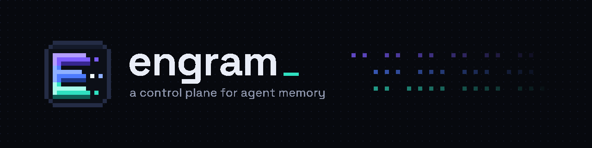
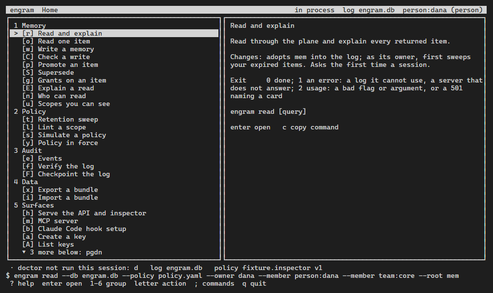
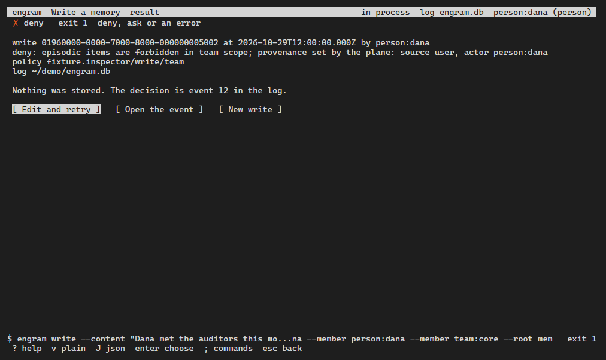
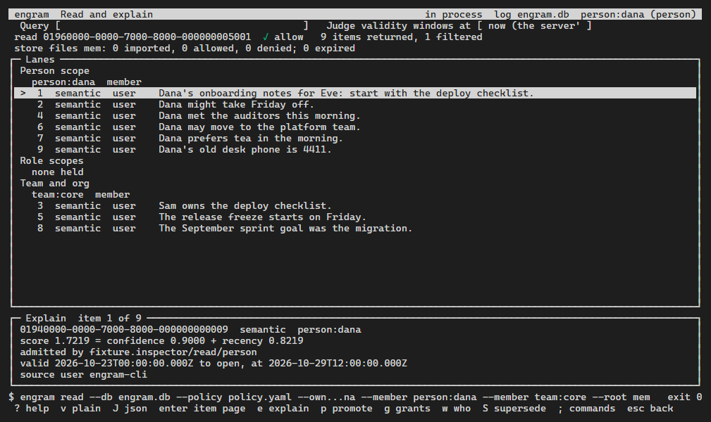

<p align="center"></p>

# Engram

Engram is a control plane for the long-term memory of AI agents. It sits between an agent and the store that holds its memory (a folder of Markdown files such as Claude Code's memory, an in-process Mem0, or a Letta MemFS repository, which is git-backed Markdown) and decides every write and every read by a typed policy: who may write what into which scope, who may read it back, how long it stays valid, and where it came from. Every decision is appended to a hash-chained event log with its reason and the rule that made it, and every item a read returns can be explained. The store's own code is not changed: it keeps the bytes, and the plane keeps the metadata (scope, provenance, validity, grants, status). The plane never calls a model.

Engram is a graduation project at Egypt University of Informatics with a thesis attached. Its experiment programme asks one question, registered before any run: what does enforcing memory governance at the boundary cost, compared with asking the model to behave?

## Contents

- [What Engram is](#what-engram-is)
- [The three products](#the-three-products)
- [The terminal interface](#the-terminal-interface)
- [Getting started](#getting-started)
- [What landed recently: the absorb plan](#what-landed-recently-the-absorb-plan)
- [Why it exists](#why-it-exists)
- [How it fits together](#how-it-fits-together)
- [Status, 2026-11-26](#status-2026-11-26)
- [The research programme](#the-research-programme)
- [Common commands](#common-commands)
- [Repository map](#repository-map)
- [Contributing](#contributing)
- [What is next](#what-is-next)
- [Licence and attribution](#licence-and-attribution)
- [Links](#links)

## What Engram is

Agents now keep memory across sessions: facts about a user, decisions of a team, procedures that worked. Most memory stores take whatever the agent writes and return whatever matches a query. Engram puts a gate in front of the store.

**The plane.** Six mechanisms, all in [`packages/core`](packages/core/README.md):

| mechanism | what it does |
|---|---|
| write gate | `Plane.write` checks the writer's membership of the target scope, the item's class, its source (user, document, tool, model, import, compaction, external) and its confidence against the policy before the store is touched. A denied write never reaches the store. Opt-in policy blocks add content guards (secrets, personal data, instructions injected for the agent) and trust floors (an unattested write lands at the least trusted kind; a less trusted source cannot rewrite, retire or evict a more trusted item). Both are off by default and in every registered preset. |
| read filter | `Plane.read` admits only items in scopes the reader may read, or reached through a grant that names it, and only inside their validity window and time to live. Filtering comes before ranking, so hidden items never take a place in the results. A read by id answers an id out of reach as unknown (ADR [0047](docs/decisions/0047-by-id-read-and-scope-list.md)). |
| event log | Every decision appends one `MemoryEvent` with the actor, the scopes, the decision (allow, deny or ask), a `reason` and a `policy_id`. The log is the source of truth: the item set is a projection of it. SQLite by default, Postgres as an option. Every event is hash-chained, what offboarding erases is held as a salted commitment so erasure still works, and `engram log checkpoint` signs the chain's head (ADR [0038](docs/decisions/0038-tamper-evident-log-that-keeps-erasure.md)). |
| explain | Every item a read returns carries its score components (relevance, confidence, recency), its rank, the rule that admitted it, the grants it used and its validity window. `Plane.explain` returns them to the reader who made the read, and to no one else. |
| who can read | For an item or a scope, the plane lists who may read it, each reader with the rule or grant that admits them, answered only to someone who may read it (card E2.13). |
| replay | The item set as it stood after any event can be rebuilt from the log alone (`itemsAt`), and a recorded workload can be replayed under another policy to see what would change (`Plane.simulate`, `engram simulate`). |

Terms such as *scope*, *grant*, *provenance*, *preset*, *cassette*, *task card*, *gate*, *MemFS*, *absorb plan* and *governance tax* are defined in the [glossary](docs/glossary.md). A *preset* is one of three bundled policies, strict, medium and permissive. A *task card* is one unit of work under `docs/tasks/`, named by an id such as E2.9 (its epic and number).

**Where it runs.** Engram is built on [pi](https://pi.dev) (ADR [0001](docs/decisions/0001-pi-as-base.md)). Inside pi, the Engram extension intercepts writes in pi's `tool_call` handler and reads in its `context` handler, mirrors every decision into the pi session as a custom entry, and blocks shell commands and file tools that would reach a store directly. Claude Code and Codex reach the same plane through an MCP server, and Claude Code also gets a PreToolUse hook that blocks direct store access. Beside them: the `engram` CLI and its terminal interface, an HTTP API with a browser inspector, and a framework kit with a Vercel AI SDK middleware. No surface holds policy logic: each one calls core.

## The three products

Three products sit on the one plane. Each is a policy profile plus a few commands and screens.

**Govern: trusted organisational memory.** Profile [`knowledge.yaml`](packages/pi-package/profiles/knowledge.yaml). What works today:

- provenance on every item, validity windows, retention by time to live and by budget, and promotion from a person's scope to a team's through a review gate;
- lints that flag what should not be trusted: a deterministic tier (expired items, changed or missing provenance, orphans, items in a scope that no longer allows their class, exact duplicates and injection signatures), a near-duplicate tier on MinHash candidates (card L5), and model-based checks for contradiction and unsupported claims (card L3) with an optional local NLI tier that drops consistent pairs before the model (card L7); the newer tiers are off in every registered preset;
- `engram supersede`, which proposes an end date for each older version of a fact a newer one replaces, never retires anything, and writes each accepted close through the gate (card L6);
- a tamper-evident log that `engram log verify` checks (card E1.6), decisions exported as content-free OpenTelemetry spans when asked (card E8.13), and the policy exported to Cedar with a differential test against Engram's own evaluator (card E2.12; the typed evaluator stays the authority).

**Twin: a memory per person.** Profile [`twin.yaml`](packages/pi-package/profiles/twin.yaml). A person scope, private by default, and role scopes that pass to a successor when the person leaves. What works today:

- explicit grants, each naming a class, a mode and an expiry, changed only by the item's owner as a governed write (ADR [0034](docs/decisions/0034-grant-change-is-the-owners-governed-write.md)), and editable in the inspector and the terminal interface;
- who can read this memory, for any item or scope;
- `engram export` and `engram import`: a versioned bundle of what you may read ([`docs/bundle.md`](docs/bundle.md)), optionally encrypted with age, and imported row by row through the write gate, never at more trust than `import` (card E9.8);
- offboarding with a deletion report (a core function; no surface calls it yet), and a dogfood kit that checks a member's own log for violations and reports only counts ([`docs/dogfood.md`](docs/dogfood.md)).

**Distill: procedures mined from agent sessions.** Admitted only after replay validation on held-out tasks. What works today:

- the session recorder, which turns pi sessions into episodes (card D1);
- induction with Agent Workflow Memory's prompt, adapted to tool-use sessions, writing each candidate as a SKILL.md (card D2, ADR [0045](docs/decisions/0045-awm-prompt-adapted-to-tool-use.md)); a rule-based method is kept as a fixture-only control;
- the replay validation gate: `Plane.promote` admits a procedure only when it passes 4 of 5 held-out tasks, each at a mean reward of at least 2/3 over seeds 1 to 3 and no worse than without it, and derives the record itself from the outcomes (card D3, ADR [0046](docs/decisions/0046-replay-validation-source.md)).

Not built yet: retirement on drift (card D4), and `Plane.distill` as one call (induction runs through the experiment runner today).

## The terminal interface

`engram tui` opens a full-screen interface over every command (card E8.15, design [`docs/design/tui.md`](docs/design/tui.md), ADR [0044](docs/decisions/0044-cli-tui.md)). It teaches the CLI rather than hiding it: each screen shows the exact `engram ...` command it would run, runs that same command, and on quit prints the session's commands, ready to paste into a script. Anything that changes state asks first. The screenshots below are generated by `make tui-screens` from a fixture workspace; [`docs/design/screens/index.md`](docs/design/screens/index.md) lists every screen.

**Home.** Every command in six groups, each with its own key, and what the selected one changes and how it exits.

<p align="center"></p>

**A denied write.** The decision first, then the gate's reason and the policy id verbatim. Nothing was stored, and the denial is itself an event in the log.

<p align="center"></p>

**Read and explain.** The items the reader may see, in person, role and team lanes, and the selected item's score components and the rule that admitted it.

<p align="center"></p>

Line mode (`engram tui --line`) asks one question a line, for screen readers. More screens, the keys and the accessibility options are in [`packages/cli/README.md`](packages/cli/README.md#the-terminal-interface-engram-tui).

## Getting started

You need Node 24 or later, [pnpm](https://pnpm.io) and [uv](https://docs.astral.sh/uv/), and git on the path for the Letta adapter. No Docker, and no model key: everything below runs offline.

### 1. Install and check

```sh
git clone <this repository> engram && cd engram
pnpm install && uv sync
make engram ARGS="doctor"
```

`engram doctor` checks the log (never creating one), the policy, the store, the three adapters (a write and a read through the plane on Mem0 and on Letta, offline), provider keys by name only, the benchmark pins and fixture hashes, the pi pin and Node. `make test` runs the whole test suite.

The `engram` command is `packages/cli/src/main.ts`. Run it as `make engram ARGS="<command> ..."` or `node packages/cli/src/main.ts <command>`. The examples below write `engram` for short; to type them as written, run this once in the clone's root:

```sh
alias engram="node $PWD/packages/cli/src/main.ts"
```

### 2. The terminal interface

```sh
engram tui
```

Without a saved workspace it starts on First run, which asks for a log, a policy and who you are. With flags (`--db`, `--root`, `--owner`, `--policy`, `--as`, `--member`) it opens on Home over that workspace. `?` shows the keys on any screen, `;` opens the command palette, and `q` on Home quits.

### 3. The CLI: write, read and explain

```sh
mkdir -p /tmp/engram-demo/memory
engram write --root /tmp/engram-demo/memory --owner alice --db /tmp/engram-demo/engram.db \
  --content "The deploy key rotates every 90 days."
engram read deploy --root /tmp/engram-demo/memory --owner alice --db /tmp/engram-demo/engram.db
```

The write prints its decision, its rule and its reason:

```
allow: semantic item from source user passes the person write rule; provenance set by the plane: source user, actor person:alice
policy preset.medium/write/person
```

The read prints each returned item with its score components and admitting rule, and ends with the command that explains it:

```
1. 01a2180d-...  semantic  person:alice
   score 2.9000 = relevance 1.0000 + confidence 0.9000 + recency 1.0000
   admitted by preset.medium/read/person
```

Now try someone else:

```sh
engram read deploy --root /tmp/engram-demo/memory --owner alice --db /tmp/engram-demo/engram.db --as person:bob
engram write --root /tmp/engram-demo/memory --owner alice --db /tmp/engram-demo/engram.db \
  --as person:bob --scope person:alice --content "x"
```

The read as bob returns nothing and counts one item out of his reach. The write as bob into `person:alice` is denied with `policy engram/write/membership` and exits 1. Every one of these is an event in the log; `engram who-can-read --scope person:alice ...` says who may read alice's scope, and `engram log verify --db /tmp/engram-demo/engram.db` checks the chain (it answers UNSIGNED, exit 3, until a signed checkpoint covers the log).

### 4. Claude Code and Codex, through MCP

`engram mcp` serves the tools `memory_write`, `memory_read`, `memory_explain` and `memory_simulate` (and `memory_supersede` with `--supersede`) over stdio, every call as one fixed actor with source `model`. Working configurations are in [`fixtures/harness/`](fixtures/harness/README.md):

- Claude Code: [`claude-code/.mcp.json`](fixtures/harness/claude-code/.mcp.json) for the server, and [`claude-code/.claude/settings.json`](fixtures/harness/claude-code/.claude/settings.json) for the PreToolUse hook `engram hook claude-code`, which denies shell commands and file tools that would touch the store or the log.
- Codex: [`codex/config.toml`](fixtures/harness/codex/config.toml), MCP only.

The fixtures call `engram`; put the CLI on your path, or replace `engram` with `node <clone>/packages/cli/src/main.ts`. The terminal interface's MCP screen prints both configurations for your workspace.

### 5. The HTTP API and the inspector

```sh
make ui              # build the inspector once, into packages/ui/dist
engram serve --root /tmp/engram-demo/memory --owner alice --db /tmp/engram-demo/engram.db \
  --insecure-loopback --as person:alice --member person:alice
```

Then open `http://127.0.0.1:7313/` for the inspector (scope lanes, timeline, explain view, item pages with a provenance graph, an event table and a version diff, who can read, the twin screens and the grants editor) and `http://127.0.0.1:7313/api/v1/health` for the API. The server refuses to start without a way to know its callers: `--keys <file>` accepts API keys made by `engram key create`, `--issuer` with `--jwks` and `--subjects` accepts JWT access tokens, and `--insecure-loopback` takes self-asserted actors on loopback only (card E8.12, ADR [0042](docs/decisions/0042-verified-actors.md)). Other commands talk to it with `--server http://127.0.0.1:7313`.

### 6. pi, with the extension

```sh
npm i -g @earendil-works/pi-coding-agent@1.3.0
pi                   # in the clone; accept project trust once
```

The repository's [`.pi/settings.json`](.pi/settings.json) loads the Engram pi package ([`packages/pi-package`](packages/pi-package/README.md)), so the session gets the memory tools, the `engram` skill and the `/engram` prompt template. The package reads `ENGRAM_ROOT`, `ENGRAM_STORE`, `ENGRAM_POLICY`, `ENGRAM_OWNER`, `ENGRAM_AS`, `ENGRAM_MEMBER` and `ENGRAM_DB_URL`; by default the store is `.engram/memory` in the project, the log is `<home>/.engram/engram.db`, and the actor is `person:<your login>`.

### 7. Your own agent framework

[`@engram/kit`](packages/kit/README.md) holds what every framework adapter repeats (a fixed actor, a namespace to scope mapper, a typed rejection), and [`@engram/ai-sdk`](packages/ai-sdk/README.md) puts governed recall into a Vercel AI SDK model call as a middleware, with `remember` and `recall` tools (card E8.14). Both reach the plane only through the generated client.

## What landed recently: the absorb plan

On 2026-11-21 the team read the field again (111 fact-checked notes in [`docs/readings/litreview/`](docs/readings/litreview/README.md)) and chose thirty pull requests that take in what is worth taking from open-source projects and recent papers ([`docs/tasks/absorb-plan.md`](docs/tasks/absorb-plan.md)). All thirty merged on 2026-11-21 and 2026-11-22, as PRs #69 to #110. Every piece of code or data copied or ported, each from a source under an allowed licence, is registered in [`docs/absorbed.md`](docs/absorbed.md) (ADR [0037](docs/decisions/0037-absorbing-open-source.md)).

| area | cards | what it added |
|---|---|---|
| research design | R2, R3, R4 | the proposed arms, written as proposals in the pre-registration; the novelty claim restated against HEAMS and SAFE-Mem ([`docs/research/positioning.md`](docs/research/positioning.md)); the claims crosswalk from each claim to its test ([`docs/compliance/`](docs/compliance/README.md)) |
| trust at the gate | E2.7, E2.8, E2.9, E2.10, E2.11 | tests that confirmed two trust gaps, then the fixes as opt-in policy: the secret and personal-data guard, the deterministic injection screen, and trust floors with an eighth invariant |
| correctness | A5, E1.4, E1.5, E1.6 | conformance cases for capability claims and a revocation grid per store; a stateful model-based test of the Plane with crash windows; a Quint model of the commit and erasure protocol ([`specs/`](specs/README.md)); the tamper-evident log with a ninth invariant |
| lints | L5, L6, L7 | the near-duplicate tier, the supersession helper and the local NLI tier for the contradiction lint |
| who sees what | E2.12, E2.13, E8.11 | the policy exported to Cedar; who can read; the inspector's item page |
| surfaces | E8.12, E8.13, E8.14, E9.8 | verified actors on the HTTP API and MCP over HTTP; OpenTelemetry export; the framework kit and the AI SDK middleware; export and import |
| benchmarks | B7, B10, B11, X14, X15 | MERIT and tau2-bench through the plane, run unmodified as external processes behind the cassette proxy; a red-team harness on OWASP's AMSB scenarios and pinned payload sets with benign controls; the plane's latency against bare SQLite |
| Distill | D1, D2, D3 | the session recorder, induction and the replay validation gate (above) |

Beside the plan: the terminal interface (card E8.15, design on main since PR #96, implementation on branch `cliupgrade`), and on 2026-11-25 the lead accepted ADRs 0034 and 0042 to 0048 and asked for a second plan of thirty ([`docs/tasks/absorb-plan-2.md`](docs/tasks/absorb-plan-2.md)).

## Why it exists

Telling a model the rules ("do not reveal another user's notes") is a request, not a guarantee. Engram enforces the rules in code, before the model sees anything, and records why. The thesis measures what that costs.

The novelty claim, exactly as card R3 restated it in [`docs/research/positioning.md`](docs/research/positioning.md):

> To our knowledge, Engram is the first deterministic, event-logged, replayable control plane across memory stores, with a pre-registered measurement of its governance tax.

Each word is a condition, and the claim is only as strong as the weakest:

- **Deterministic.** Every decision is a pure function of the typed policy, the actor, the item and the time, evaluated by code. No model makes a decision or sets a trust-bearing input: the provenance kind and the actor come from the harness, and the scope, class and confidence a writing agent chooses are checked against the policy.
- **Event-logged.** Every decision is a `MemoryEvent` with a reason and a policy id, and the log is the source of truth.
- **Replayable.** State is rebuilt from the log alone (except items later erased by offboarding, which never come back), and a recorded workload replays every decision under any policy. A single decision cannot be decided again from events alone, because a denied write's event carries no item and a read's event carries no query (ADR [0032](docs/decisions/0032-simulator-replays-recorded-calls.md)).
- **Across memory stores.** One adapter contract, one conformance suite, three adapters. Store independence is a design property (ADR [0035](docs/decisions/0035-store-independence-is-a-design-property.md)); the request-identity check meant to prove it is not built yet, and the registered H1 runs use one store, Mem0.
- **Pre-registered measurement of its governance tax.** H1 and H2 register the cost of enforcement before any run. The analysis is to be tagged `prereg-v1` and deposited before the first run (ADR [0023](docs/decisions/0023-preregistration-in-repo.md)); today only `prereg-v0` is tagged, and nothing has run. The claim is about what is registered, not about a result.

What the claim no longer says: "the first governance layer over existing stores" (HEAMS, arXiv 2611.20144, ships one), "the first measured governance tax", "the first to log each decision with its reason", and "the first deterministic policy on memory reads" (HEAMS offers deterministic rules too). The positioning document gives the evidence for each withdrawal and compares Engram with HEAMS and SAFE-Mem (arXiv 2610.22959) row by row.

## How it fits together

```
 Agents and harnesses   pi (extension)   Claude Code, Codex (MCP, hook)   a person   any HTTP client   AI SDK apps
                               \                  |                          |            |               |
 Surfaces               pi-extension         mcp                  cli + tui        server + ui     kit, ai-sdk
                               \                  |                          |            |               /
 Engram plane           packages/core: schema, hash-chained event log, policy engine, content guards,
                        trust floors, lints, explain, who can read, replay, simulator, distill, offboarding
                                                          |
 Adapters               packages/adapters: files (Claude Code memory), Mem0, Letta MemFS
                                                          |
 Stores                 unchanged
```

Two rules keep this buildable by four people and their coding agents: logic lives only in `packages/core` and `packages/adapters`, and the schema in `packages/core/src/schema.ts` is the contract from which JSON Schema, the OpenAPI document, the TypeScript client and the Python types are generated (`make api`). The full design, with the write path, the read path, retention, lifecycle, tamper evidence, decision export and every interface, is [`docs/architecture.md`](docs/architecture.md).

## Status, 2026-11-26

The project started on 5 October 2026 and submits in the last week of March 2027 ([`docs/roadmap.md`](docs/roadmap.md)). It is in week 8, phase 2 ("First result"). A *gate* is a go or no-go checkpoint with written criteria; there are four, A to D. Gate A was declared passed with two exceptions on 2026-10-29 ([log](docs/log/2026-10-29-gate-a-milestone-corrected.md)); Gate B's engineering was done the same day and proposed as passed with exceptions that wait on the pre-registration ([log](docs/log/2026-10-29-gate-b-engineering-done.md)).

**What works, merged on main.** The plane and its six mechanisms; three adapters behind one contract and one conformance suite; every surface (the pi extension and package, MCP over stdio or HTTP, the Claude Code hook, the CLI, the HTTP API with its generated OpenAPI document and client, the inspector, the framework kit and the AI SDK middleware); lints L1 to L7; the simulator; the three presets and the Knowledge and Twin profiles; benchmark harnesses for GateMem, LongMemEval, MEM-INV-Bench, MERIT and tau2-bench through the plane; the experiment runner, with conditions C1 to C5 as seeded, cached pi SDK sessions, live and replay modes, resume, shards and spend ceilings; and nine invariants run against the real Plane (`make test-invariants`). The terminal interface is on branch `cliupgrade`, to be merged next.

**What is measured.** Only offline results, each regenerated by a script from a config and listed in [`research/results/MANIFEST.md`](research/results/MANIFEST.md) (24 rows): what the plane admits on GateMem and MEM-INV-Bench, the H4 power simulation, the deterministic lint floor on LongMemEval's memory, the seeded-fault set, the cost tables, the label-audit draws, the claims crosswalk, and the engineering checks of the absorb cards (the injection screen, the secret guard, the latency budget, the red-team run, the near-duplicate tier and the NLI tier). The engineering checks enter no registered analysis. For example, all registered runs together are estimated at 1,159 to 5,227 dollars at OpenRouter's list prices ([`research/results/h2-cost-table.json`](research/results/h2-cost-table.json), the `decided` block, the lead's models). No live model result exists yet.

**What is pending.** The three members' label audit (23 to 28 November), the runner's remaining pre-tag work (refused calls recorded as exclusions, the spend cap checked in billed dollars), the smoke run and B1, then the `prereg-v1` tag and its Zenodo deposit by 30 November, and H1's live runs from 1 December.

**Known limits, stated rather than hidden.**

- Identity is verified only on the HTTP surfaces, and only when the server is started with keys or a token issuer. The CLI in process, MCP over stdio and `--insecure-loopback` take `--as` and `--member` as given.
- The log's chain proves nothing against someone with database access unless a signed checkpoint is kept outside the database; `engram log verify` then answers UNSIGNED, never OK. The chain covers the log, not what an erasure may have left in a store.
- Content guards and trust floors are opt-in and off in every registered preset, so the registered runs measure the plane without them.
- Outside pi the guarantee is weaker: MCP reads are filtered by scope and grants, but nothing governs what the harness already holds in its context (condition C7), and Codex has no hook yet (ADR [0022](docs/decisions/0022-other-harnesses-through-mcp.md); card E8.17 of the second plan adds one).
- `Plane.distill` as one call, drift retirement (D4) and condition C6 (enforcement with lints) in the runner are not built.
- The plane misses its proposed latency budget (proposed by card X15, not yet accepted) in three of four cells, measured at p99 on the fake store: a read of ten items takes 63.4 ms against 50 ms at 1,000 items and 203.4 ms against 100 ms at 10,000; a write meets its budget at 1,000 items (14.4 ms against 50 ms) and misses it at 10,000 (163.3 ms against 100 ms). Every call reads whole tables (the `budget` block of [`research/results/h2-perf-budget.json`](research/results/h2-perf-budget.json); the findings are in [`docs/tasks/backlog.md`](docs/tasks/backlog.md)).

## The research programme

The question: what does enforcing memory governance at the boundary cost, compared with asking the model to behave, across stores and models? The design is registered in [`docs/research/preregistration.md`](docs/research/preregistration.md) (v1, answered, untagged until its pre-tag conditions hold).

**Hypotheses.** Holm adjusts the five primary p-values at a family-wise alpha of 0.05.

| | statement, in one line | conditions | benchmarks |
|---|---|---|---|
| H1 | Enforcement beats instruction: C5 leaks less than C3 and C4 on the primary model. | C2 to C5 | GateMem, MEM-INV-Bench |
| H2 | The governance tax has a knee: a preset keeps at least 90 percent of ungoverned utility with at most 20 percent of its violations. | C1, C2, C5 | GateMem, LongMemEval, MERIT |
| H3 | Lints recover part of the utility enforcement loses, at matched token budget. | C5, C6 | LongMemEval |
| H4 | Under enforcement the violation rate does not depend on the model (equivalence within 5 points); store independence is a design property. | C2, C5 | GateMem |
| H5 | Procedures admitted only after replay validation raise task success over the same procedures admitted ungoverned. | C1, C2, C5 | tau2-bench |

**Conditions.** How memory reaches the agent; the runner states each one's mechanism in `CONDITION_TABLE` (`packages/runner/src/config.ts`).

| id | name | memory path |
|---|---|---|
| C1 | no memory | long context only |
| C2 | ungoverned | the store directly |
| C3 | instruction | the store directly, with the policy as text in the system prompt |
| C4 | instruction with metadata | as C3, and each read item carries metadata for the model to decide from |
| C5 | enforced | the Engram plane: write gate and read filter, before the model call |
| C6 | enforced with lints | as C5, plus the preset's lints (not built in the runner yet) |
| C7 | governed tools without read filtering | the Engram tools over MCP; run by no hypothesis since 2026-11-20 |

**Benchmarks**, each pinned to one upstream commit in [`packages/bench/PINS.md`](packages/bench/PINS.md): GateMem (2,218 checkpoints), MEM-INV-Bench (38 laundering-channel cases), LongMemEval (500 questions, cleaned S split), MERIT, MemoryAgentBench (pinned, run by no hypothesis) and tau2-bench (v1.0.1).

**Models**, chosen by the lead on 2026-11-20, all through OpenRouter on a seeded API: M1 DeepSeek v4 pro (primary), M2 GLM 5.3 Flash and M3 Mistral Large 4 (fixed subsets). Three seeds. Every model call is cached on (benchmark item, condition, preset, store, model, seed, prompt hash), so a rerun makes zero new calls (ADR [0017](docs/decisions/0017-cached-metered-seeded-model-calls.md)). H1 is 26,616 GateMem sessions and 456 MEM-INV-Bench sessions on M1, as `make run ... COUNT=1` counts them.

**Where results live.** A result exists only if `research/scripts/<name>.py` regenerates it from `research/configs/` into `research/results/`, with a row in [`research/results/MANIFEST.md`](research/results/MANIFEST.md) (AGENTS.md rule 9). [`research/README.md`](research/README.md) explains how to reproduce one.

## Common commands

A selection, grouped. [AGENTS.md, "Commands"](AGENTS.md#commands) is the full list, and `make help` and `engram --help` print what is installed.

| task | command |
|---|---|
| install once | `pnpm install && uv sync` |
| all tests | `make test` |
| one test file | `make test-one T=<path>` |
| the invariants against the real Plane | `make test-invariants` |
| lint code and docs | `make lint`, `make lint-docs` |
| end to end (CLI, MCP, hook, inspector in Chromium) | `make test-e2e` (it runs `make ui` itself; once first: `pnpm exec playwright install chromium`) |
| regenerate the contracts and clients | `make api`; `make api-check` fails on a diff |
| the Quint model of the commit protocol | `make verify-spec` |
| the terminal interface | `engram tui`, or `engram tui --line` |
| the CLI | `engram write \| read \| promote \| supersede \| explain \| retain \| lint \| simulate \| export \| import \| who-can-read \| serve \| mcp \| hook claude-code \| key \| doctor \| log verify \| log checkpoint` |
| a benchmark on its fixture subset, offline | `make bench BENCH=gatemem` (also `longmemeval`, `merit`, `tau2`; MERIT and tau2 fetch their pinned harness once) |
| the red-team harness, model-free (fetches its pinned payload sets once) | `make redteam` |
| replay a runner config from its cassettes | `make run CONFIG=research/configs/rn1-gatemem-probe.json` |
| count a run's sessions, no model called | `make run CONFIG=research/configs/h1-gatemem.json COUNT=1` |
| rerun every committed result and compare hashes | `make test-repro` |
| consolidate the log into thesis drafts | `make thesis` |

## Repository map

| path | what |
|---|---|
| [`packages/core`](packages/core/README.md) | the plane: schema, events and the chain, policy, guards, lints, explain, replay, simulator, distill, offboarding. No store I/O, no model calls |
| [`packages/adapters`](packages/adapters/README.md) | files, Mem0, Letta; each implements the Adapter contract; the conformance suite |
| [`packages/pi-extension`](packages/pi-extension/README.md) | the Engram pi extension: tools, `tool_call` and `context` handlers, custom entries, session replay |
| [`packages/pi-package`](packages/pi-package/README.md) | the distributable pi package: extension, skill, prompt template, profiles |
| [`packages/mcp`](packages/mcp/README.md) | the MCP server for Claude Code and Codex; the Claude Code hook |
| [`packages/tag`](packages/tag/README.md) | the memory tag and the memory_write and memory_read definitions, pure, no pi |
| [`packages/kit`](packages/kit/README.md) | the framework kit: a fixed actor, a namespace to scope mapper, a typed rejection; the adapter conformance suite |
| [`packages/ai-sdk`](packages/ai-sdk/README.md) | `@engram/ai-sdk`: governed recall as a Vercel AI SDK middleware, remember and recall tools |
| [`packages/cli`](packages/cli/README.md) | the `engram` command and its terminal interface |
| [`packages/server`](packages/server/README.md) | the HTTP API, its authentication, its route table, the workspace opener |
| [`packages/ui`](packages/ui/README.md) | the inspector, on the generated client |
| [`packages/view`](packages/view/README.md) | the pure view logic the inspector and the TUI share, with no React |
| [`packages/bench`](packages/bench/README.md) | benchmark harnesses through the plane, pinned in `PINS.md`; the red-team harness |
| [`packages/runner`](packages/runner/README.md) | the experiment runner: conditions as seeded, cached pi SDK sessions; induction and replay validation |
| [`packages/model`](packages/model/README.md) | the cached, seeded model call, the scripted models, the cassette proxy and the NLI scorer |
| [`research/`](research/README.md) | Python: configs, scripts, results, analysis, thesis drafts |
| [`specs/`](specs/README.md) | the Quint model of the commit and erasure protocol |
| `sdk/` | generated JSON Schema, OpenAPI and TypeScript client; do not edit |
| [`docs/`](docs/README.md) | architecture, roadmap, decisions, tasks, design, research, readings, log, conventions |
| [`fixtures/`](fixtures/) | sessions, stores, faults, cassettes (recorded model replies, replayed so a rerun calls no model), benchmark subsets; regenerated only by `make fixtures` |
| [`scripts/`](scripts/) | the repository's own checks: `make lint-docs` (prose, log entries, the PR gate) and their tests |
| [`test/e2e/`](test/e2e/) | layer 6, `make test-e2e`: the CLI, the MCP handshakes, the hook and the inspector in Chromium |
| [`.pi/`](.pi/) | pi's project settings (loading the Engram package), the appended system prompt and the prompt templates for working on this repository |
| [`.claude/`](.claude/) | Claude Code's settings and commands for working on this repository |
| [`.github/`](.github/) | the PR template |
| [`AGENTS.md`](AGENTS.md) | the operating manual; `CLAUDE.md` is a checked copy |

## Contributing

Read [`AGENTS.md`](AGENTS.md) in full first: its rules are binding on people and coding agents alike. A new team member then reads the required tier of [`docs/readings/README.md`](docs/readings/README.md) and writes a note per paper, then [`docs/decisions/0001-pi-as-base.md`](docs/decisions/0001-pi-as-base.md) and [`docs/architecture.md`](docs/architecture.md). In short:

1. **Work is cut into task cards** under [`docs/tasks/`](docs/tasks/), each with a goal, the files it may touch, its dependencies, an acceptance command and what is out of scope. One card per pull request; its title is the card id and goal. Start only when every card it depends on is merged.
2. **Plan, test first, implement.** Propose the plan in the PR description, write the acceptance test before the code, and follow [`docs/conventions/testing.md`](docs/conventions/testing.md): fakes not mocks, scripted or cassette models, an injected clock and seeds.
3. **Log every step.** Each PR adds an entry under [`docs/log/`](docs/log/) in the format of [`docs/conventions/documentation.md`](docs/conventions/documentation.md), failures included; `make thesis` turns the log into chapter drafts.
4. **Keep the rules.** Policy logic only in core; stores only through `Plane.read` and `Plane.write`; no em dashes; a new dependency gets a row in [`docs/deps.md`](docs/deps.md); absorbed open-source code follows [`docs/conventions/absorption.md`](docs/conventions/absorption.md).
5. **Pass the gates locally:** `make lint`, `make lint-docs`, `make test` and the card's acceptance command, then open the PR with [the template](.github/PULL_REQUEST_TEMPLATE.md) filled in.

A choice another card could have made differently gets an ADR under [`docs/decisions/`](docs/decisions/README.md) (0001 to 0048 so far).

## What is next

- **By 30 November.** The label audit, the runner's remaining pre-tag work, the smoke run and the GateMem reference check (B1), then the `prereg-v1` tag and its Zenodo deposit. The eight pre-tag conditions are listed at the head of the pre-registration. Before the tag only documents, tests and test tooling merge.
- **1 to 8 December.** H1's live runs on M1: GateMem as four shards in parallel, then MEM-INV-Bench, then `make h1-table` and `make h1-figure`. Until H1's shards are merged, nothing merges that changes code a registered config runs.
- **13 December, Gate C.** If enforcement beats instruction, the programme continues as planned; if not, the thesis pivots to where boundary enforcement fails and why; an undecided read-out continues and lets the final Holm decide.
- **The second absorb plan,** weeks 8 to 16 ([`docs/tasks/absorb-plan-2.md`](docs/tasks/absorb-plan-2.md)): on the research side, determinism guards, a cross-surface leak suite, Quint traces replayed against the Plane, a mutation audit of the invariants, a results page, two erasure gaps closed, the paired fault-injection check for H3, a fourth store and drift retirement (D4); on the product side, `engram discover`, consent at the write gate, a Codex hook, crypto-shredded erasure with a signed receipt, an approval queue on every surface, `engram policy test` and `diff`, a signed audit report and a subject access export.
- **24 January 2027, Gate D.** The frontier figure on at least two policy levels, two stores (met by the request-identity check of ADR 0035, not by paid runs on each store) and two models, lint precision and recall on the seeded faults, and the Knowledge and Twin profiles on the team's own dogfood data with zero recorded violations ([`docs/dogfood.md`](docs/dogfood.md)).
- **February and March.** H3 and H5, failure analysis, the reproduction script, the thesis and its defence.

## Licence and attribution

The code is licensed under the Apache License 2.0 ([`LICENSE`](LICENSE), ADR [0020](docs/decisions/0020-licence.md)); the licence of the thesis text and figures is not decided yet. [`NOTICE`](NOTICE) carries the notices that copied code requires, [`docs/absorbed.md`](docs/absorbed.md) registers every copy or port with its source, commit and licence (ADR [0037](docs/decisions/0037-absorbing-open-source.md)), and [`docs/deps.md`](docs/deps.md) lists every dependency with its reason and licence. Benchmark data keeps its own licence, recorded in `packages/bench/PINS.md`.

The thesis methods chapter states that implementation used coding agents under the conventions in `AGENTS.md`, that experiment code and analysis were hand-reviewed, and that every generated component carries tests.

The team is four members on two tracks: the platform track owns adapters, surfaces, profiles and dogfood; the research track owns the policy engine, lints, benchmark harnesses, experiments and the thesis. The lead integrates.

## Links

- [`AGENTS.md`](AGENTS.md): the operating manual, the rules and every command
- [`docs/architecture.md`](docs/architecture.md): the design
- [`docs/design/tui.md`](docs/design/tui.md): the terminal interface's design
- [`docs/roadmap.md`](docs/roadmap.md): phases, gates, weeks and task cards
- [`docs/research/preregistration.md`](docs/research/preregistration.md) and [`docs/research/positioning.md`](docs/research/positioning.md): the registered design and the novelty claim
- [`docs/decisions/`](docs/decisions/README.md): the ADRs
- [`docs/glossary.md`](docs/glossary.md): terms, and how they map to the papers'
- [`docs/compliance/`](docs/compliance/README.md): which test backs which claim, and which legal obligation it bears on
- [`docs/brand/`](docs/brand/README.md): the logo kit
- [pi](https://pi.dev): the harness Engram is built on
