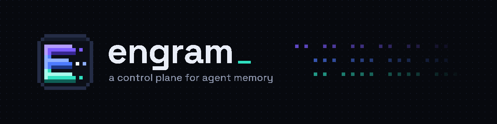

# Engram brand kit



A pixel-art mark and a Space Grotesk wordmark. Every file is a plain SVG with the type outlined to paths, so it renders the same in a GitHub README, a slide or a browser tab, with no font installed and no request made.

## The mark

An E of three memory slabs, each lit from above and casting a shadow, with a trace of pixels leaving each slab: the engram, a memory's physical trace. The three slabs run violet, blue and teal, top to bottom. It is drawn on a 16 by 16 grid; scale it by whole multiples of 16 px so the pixels stay square.

| file | use |
|---|---|
| `engram-mark.svg` | the mark on its dark tile: avatars, app icons, anywhere square |
| `engram-mark-transparent.svg` | the mark alone, on any background |
| `engram-favicon.svg` | the tile at 16 px, for `<link rel="icon">` |
| `engram-logo-light-text.svg` | tile and wordmark, light text, transparent: dark backgrounds |
| `engram-logo-dark-text.svg` | tile and wordmark, dark text, transparent: light backgrounds |
| `engram-logo-card.svg` | tile and wordmark on a dark card with the dot grid |
| `engram-wordmark-light-text.svg`, `engram-wordmark-dark-text.svg` | the word alone |
| `engram-banner.svg` | 1280 by 320 README header, with a blinking cursor |
| `engram-social.svg` | 1280 by 640 social card; `png/engram-social-1280.png` is the one to upload as the GitHub social preview |
| `png/` | PNG exports for places that take no SVG |

## In a README

The banner carries its own dark background, so it reads in both GitHub themes:

```html
<p align="center"></p>
```

The transparent logo switches with the reader's theme:

```html
<picture>
  <source media="(prefers-color-scheme: dark)" srcset="docs/brand/engram-logo-light-text.svg">
  
</picture>
```

## Palette

| role | hex |
|---|---|
| ink (backgrounds) | `#07090e` |
| tile | `#0c0f17`, outline `#242c45`, lit row `#141a2a` |
| text on dark | `#e9edf7`, dim `#8b93a9` |
| text on light | `#0b0e16` |
| violet slab | light `#b49dff`, base `#7c5cff`, shadow `#36268f` |
| blue slab | light `#8fb0ff`, base `#4d7bff`, shadow `#1d3685` |
| teal slab | light `#a8fbec`, base `#2fe0c0`, shadow `#0e5f56` |
| trace highlight | `#f4fffd` |

Type is Space Grotesk (Florian Karsten, SIL Open Font License 1.1): Bold for the wordmark, Medium for the tagline and chips.

## Rebuilding

`source/build.mjs` draws every file from the pixel map and the palette in it. It is not a workspace package, so it installs on its own:

```
cd docs/brand/source
npm install
node build.mjs
```

It writes the SVGs here and every PNG export into `png/`; commit only the PNGs the table above names.
