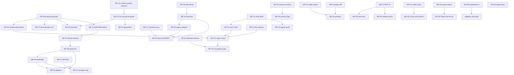

# Engram absorption master plan

Date: 2026-11-21. Inputs: 100 verified plans (plus 18 dropped), three judge rankings (thesis, product, feasibility). Repo rules cited as "rule N" are AGENTS.md rules.

## 1. Executive summary and headline

The verified plans overlap heavily (ten to eleven duplicate clusters were flagged by every judge). Merged and split along rule 5 and rule 10 (one card per PR, schema changes alone), they become 60 master PRs (MP-01 to MP-60) in three waves, plus a short unscheduled backlog. Wave 0 holds 10 PRs that touch only docs, tests, research scripts or dev tooling, so they cannot endanger Gate C or the 30 November tag. Wave 1 (Gate C to Gate D) holds 24 PRs: the deterministic hygiene and security floor, the Distill induction and replay path that H5 needs, the cassette proxy, the tamper-evident log design, import and export, and the demo surfaces. Wave 2 (after Gate D) holds 26 PRs: core schema changes, the dense retrieval tier, verified actors, framework adapters, ingestion and the heavier privacy work.

What Engram gains: (a) Part I credibility, through mechanised evidence (Cedar differential test, model-checked commit and erasure protocol, per-step stateful invariants, a revocation grid, a published latency budget, a claim-to-test crosswalk); (b) the three products made real, with Distill induction and replay validation, Twin import, erasure and consent, and Govern audit evidence (secret and PII guard, signed audit report, erasure-compatible hash chain); (c) examiner reproducibility (cassette proxy for external harnesses, a byte-stable results page tied to MANIFEST hashes, an AI-BOM).

Selection principles: nothing in Wave 0 changes `packages/core` behaviour; nothing that needs a preregistration amendment runs before the amendment is reviewed; every schema change is its own PR and precedes its consumer; every dependency respects the two-week-old exact pin rule and rule 11; rule 12 is respected by every export (content-free or read-matrix filtered).

Scoring: each judge scored 1 to 10 (T = thesis, P = product, F = feasibility). Combined priority is the mean of the three, using the primary source id of the merged plan. Where a merge spans ids, the primary id is named.

## 2. Master PR list

Legend: Eff S/M/L. Deps are master ids. Files are the main paths; every PR also adds a `docs/log/` entry (rule 14) and a `docs/deps.md` row when a dependency is added (rule 11).

### Wave 0 PRs

**MP-01 ADR 0013 amendment for Mem0 v3**
- Sources: AB-STO-7. Absorbs: Mem0 v3 migration guide (Apache-2.0, already depended on). Cognee adapter dropped.
- Goal: amend ADR 0013 line 9 (UPDATE and DELETE, graph variant) to Mem0 v3; the entity-collection text already exists in the adapter header and RV3 amendments, so do not duplicate it.
- Files: `docs/decisions/0013-*.md`, log entry. Eff S. Deps: none.
- Product: accurate store docs. Thesis: keeps ADR 0013 true for Part I. Risks: v3 guide wording unverified, so cite and re-read it. Acceptance: `make lint-docs`.
- Scores T4 P2 F8, priority 4.7 (now).

**MP-02 Memory-benchmark intake review (prereg proposal)**
- Sources: AB-EVL-7. Absorbs: MemDelta stratify-by-model advice (paper).
- Goal: add entries to the "Proposed amendments, not yet registered" section of `docs/research/preregistration.md` reviewing LongMemEval-V2 and other new benchmarks for admissibility, data licence (checked at the source), and cost. HaluMem is not re-proposed (CC-BY-NC-ND, decided out).
- Files: `docs/research/preregistration.md`. Eff S. Deps: none.
- Product: low. Thesis: decides additions before any run. Risks: unchecked data licences; list only verified ones. Acceptance: `make lint-docs`.
- Scores T6 P2 F8, priority 5.3 (now).

**MP-03 Revocation conformance grid for adapters**
- Sources: AB-SOTA-1. Absorbs: 2609.08258 scenario grid (Memory-Rebirth-Attack, Apache-2.0, ideas).
- Goal: per store, write a policy, supersede it, read through the Plane, assert the revoked item is never admitted and never outranks its replacement, under direct and indirect insertion.
- Files: `packages/adapters/test/plane/revocation.test.ts` (not `conformance/`; revocation is a Plane property). Eff S. Deps: none.
- Product: regression guard. Thesis: per-store row for H3 and H4. Risks: may pass at once; scenario authoring bias. Acceptance: `make test-one T=packages/adapters/test/plane/revocation.test.ts`.
- Scores T7 P3 F8, priority 6.0 (now).

**MP-04 Claim-to-test crosswalk and obligation map**
- Sources: AB-CMP-5. Absorbs: method of 2512.13907 (paper); Engram-authored.
- Goal: `docs/compliance/crosswalk.json` mapping governance claims to obligations, evidenced or not, and the producing test; a script generates the thesis table and fails on a missing test (rule 9).
- Files: `docs/compliance/`, `research/scripts/crosswalk.py`, `research/configs/crosswalk.json`, MANIFEST row. Eff M. Deps: none.
- Product: DPO and sales material. Thesis: governance claims mapped to real obligations. Risks: legal misstatement (cite primary text per row; state that Engram supplies evidence, not compliance). Acceptance: `make test-repro` row for the script.
- Scores T7 P5 F6, priority 6.0 (now).

**MP-05 Plane-overhead benchmark and latency budget**
- Sources: AB-PRF-1. Absorbs: tinybench (MIT, dev dep, exact pin at least two weeks old); Db.prepare counting wrapper.
- Goal: p50, p99, p99.9 of `Plane.write` and `Plane.read` across store sizes and presets against a bare `node:sqlite` baseline, into `research/results/perf-budget.json`.
- Files: `packages/core/bench/` (dev only), `research/scripts/perf_budget.py`, config, MANIFEST row, `docs/deps.md`. Eff M. Deps: none.
- Product: first quotable overhead number. Thesis: the plane is cheap enough for the request path. Risks: machine noise (report hardware and repeat counts); the `sqlite.db.query` diagnostics channel fires nothing on Node 24.14, so count via a Db.prepare wrapper. Acceptance: script regenerates the JSON within a stated tolerance band and `make test` passes.
- Scores T7 P5 F7, priority 6.3 (now).

**MP-06 Stateful model-based test of the Plane**
- Sources: AB-FRM-3. Absorbs: fast-check `fc.commands` (MIT, already installed 4.10.2).
- Goal: commands over write, read, changeGrants, promote, retain, offboard, adopt, reopen handle, clock advance, with `packages/core/src/oracle.ts` and the invariants asserted after every command, minimal shrunk sequences with seed.
- Files: new `packages/core/test/property/stateful.test.ts`, Makefile `test-invariants` extended; do not edit the lead-owned `invariants.test.ts`. Eff M. Deps: none.
- Product: bug finding. Thesis: stateful evidence for the seven invariants. Risks: overlaps the existing two-handle walk (value is per-step checking and shrinking); vacuity (reuse the oracle). Acceptance: `make test-invariants`.
- Scores T6 P2.5 F7, priority 5.2 (now).

**MP-07 Conformance cases for validity, history and graph claims**
- Sources: AB-STO-1. Absorbs: Zep paper 2501.13956 (idea).
- Goal: a fake `withValidity` mode and a capability-honesty case so `native_validity`, `native_history` and `native_graph` claims are testable. No contract change: drop `neighbors?` and the as-of argument (ADR 0035 and 0031 keep validity and ranking in core).
- Files: `packages/adapters/test/conformance/`, fakes. Eff S. Deps: none.
- Product: invisible. Thesis: closes the claim-to-evidence gap in ADR 0013. Risks: none in core. Acceptance: `make test`.
- Scores T5 P3 F7, priority 5.0 (now).

**MP-08 Results page and leaderboard**
- Sources: AB-EVL-6. Absorbs: hand-written SVG pattern of `h1_figure.py`.
- Goal: single self-contained, byte-stable HTML from `research/results/` (H1 table and figure, MANIFEST sha256 per row, cost, re-run command per row). MANIFEST rows only; no dogfood data (rule 12).
- Files: `research/scripts/results_page.py`, config, output HTML, MANIFEST row, Makefile target plus AGENTS.md line. Eff M. Deps: none.
- Product: public results. Thesis: examiners see each claim beside its hash. Risks: output must be a single file for `reproduce.py`. Acceptance: `make test-repro`.
- Scores T7 P5.5 F6, priority 6.2 (now).

**MP-09 Preregistration amendment proposals for new arms**
- Sources: AB-SEC-4, AB-SOTA-3, AB-TWN-5, AB-RET-2/6, AB-FWK-7, AB-CMPT-2/AB-SEC-3, AB-ING-5 (all gating preregistration steps).
- Goal: one docs-only PR adding the proposed arms (red-team extension of MEM-INV-Bench, paired fault-injection arm, erasure residue hypothesis, dense condition, framework seam condition, injection lint, ingestion poisoning) to the "Proposed amendments" section, each with design, metric, seed policy and stop rule. Nothing is registered or run by this PR; the lead reviews each separately.
- Files: `docs/research/preregistration.md`. Eff S. Deps: none (precedes MP-26, MP-31, MP-35, MP-41, MP-50 and MP-53).
- Thesis: unblocks six research arms. Risks: scope creep before Gate C; keep entries proposals. Acceptance: `make lint-docs`.
- Scores (composite of sources) T6 P3 F8, priority 5.7 (now).

**MP-10 Quint spec of the commit and erasure protocol**
- Sources: AB-FRM-1. Absorbs: Quint and Apalache (Apache-2.0, dev tools only).
- Goal: `specs/commit.qnt` modelling N handles over one log (decide at head, conditional append, offboard begin/sweep/report, adopt, write-after-erase) with safety invariants S1 to S4 and a broken variant Apalache must refute; `make verify-spec`, outside `make test`.
- Files: `specs/`, Makefile, AGENTS.md command line, `docs/deps.md`. Eff M. Deps: none.
- Product: finds protocol bugs. Thesis: headline bounded model-check result for Part I. Risks: needs a JVM, untested on this Windows box (spike first and record failure as a log entry); bounded, not a proof. Acceptance: `make verify-spec` passes on the good spec and refutes the broken one.
- Scores T7 P3 F5, priority 5.0 (now, spike-gated).

### Wave 1 PRs (Gate C to Gate D)

**MP-11 MinHash near-duplicate lint (deterministic tier)**
- Sources: AB-RET-5 (AB-HYG-4 consolidation deferred to backlog). Absorbs: MinHash method; datasketch (MIT) as a test oracle in `research/` only.
- Goal: word-shingle MinHash with a fixed seed inside `duplicates()` in `packages/core/src/lint/det.ts`, active only when the existing near-duplicate threshold key is set; estimated Jaccard in the finding. Character shingles under a length floor.
- Files: `packages/core/src/lint/det.ts`, `packages/core/test/unit/lint/`, `research/scripts/` oracle check. Eff S. Deps: none; land after H1 runs finish, threshold taken from the L2 set.
- Product: cheap near-duplicate detection. Thesis: completes the H3 floor for duplicates. Risks: default must stay byte-identical when the key is unset (duplicate fixtures and H3 floor must not move). Acceptance: `make test` plus unchanged `make test-repro` hashes.
- Scores T6 P5 F8, priority 6.3.

**MP-12 Declarative policy tests**
- Sources: AB-POL-4. Absorbs: OPA `opa test` and Cerbos test shapes (ideas, Apache-2.0).
- Goal: `policy-test.yaml` (actor, item, time, expected decision and rule id); runner in core behind a server route, `engram policy test` through the generated client; explain on failure; starter suite per preset.
- Files: `packages/core/src/policy/`, `packages/server/src/routes.ts`, `packages/cli`, `make api` outputs. Eff S. Deps: none.
- Product: policy authors test without TypeScript. Thesis: presets as executable documentation. Risks: CLI holds no logic (rule 1); overlap with simulate (stay decision-level). Acceptance: `make api-check` and the starter suites passing.
- Scores T4 P6 F7, priority 5.7.

**MP-13 Cedar export with differential test**
- Sources: AB-POL-1. Absorbs: Cedar and `@cedar-policy/cedar-wasm` pinned 4.14.0 exactly (4.14.1 is an empty publish; 4.15.0 qualifies after 2026-11-30), Apache-2.0, dev dependency only.
- Goal: pure `exportCedar(policy)` in core returning schema and policies, plus a property test that cedar-wasm agrees with `evaluateRead` and `evaluateWrite` over generated actors, items and times for all three presets. New ADR (amends deferral in ADR 0006; next free number).
- Files: `packages/core/src/policy/cedar.ts`, test under `packages/core/test/property/`, ADR, `docs/deps.md`. Eff M. Deps: none.
- Product: policy readable to Cedar teams. Thesis: mechanised cross-check; may expose evaluator gaps (report them as findings, not hide). Risks: grants flattened, so agreement holds modulo grants; no runtime WASM in core. Acceptance: `make test-one T=packages/core/test/property/cedar.test.ts`.
- Scores T6 P6.5 F7, priority 6.5.

**MP-14 Secret and PII guard schema and ADR**
- Sources: AB-SEC-2, AB-CMPT-1 (schema half). Goal: ADR plus the schema-only PR adding a policy `content_guards` block (schema_version bump, migration, `make api`, fixtures) per rule 5; nothing else in the PR. Files: `packages/core/src/schema.ts`, migration, `sdk/` regenerated, fixtures, ADR. Eff M. Deps: none.
- Risks: fixture regeneration; keep default empty so behaviour is unchanged. Acceptance: `make api-check` and `make test`.
- Scores T6 P8.5 F7, priority 7.2.

**MP-15 Write-gate secret and PII detectors**
- Sources: AB-SEC-2, AB-CMPT-1. Absorbs: gitleaks `gitleaks.toml` rules (MIT, 222 rules, ported as generated data, publish only the ported fraction), detect-secrets plugins (Apache-2.0, ideas), Presidio recognizers (MIT, patterns); attribution in NOTICE and `docs/deps.md`.
- Goal: pure detector stage in `evaluateWrite` (policy/evaluate.ts) denying or masking, rule id and masked excerpt in the event reason; unify with the ADR 0014 R7-9 redactor in `plane/bypass.ts` into one shared table.
- Files: `packages/core/src/policy/`, `packages/core/test/unit/`, near-miss fixtures (synthetic only, rule 12). Eff M. Deps: MP-14.
- Product: first enterprise question; needed for person-to-role promotion. Thesis: new H3-style class table with false-positive rate. Risks: RE2 to JS regex translation, catastrophic backtracking (test with a timeout), entropy noise. Acceptance: `make test` plus a coverage and false-positive script with MANIFEST row.
- Scores T6 P8.5 F7, priority 7.2.

**MP-16 Memory import and export bridge**
- Sources: AB-STO-3, AB-CMPT-7, AB-TWN-3. Absorbs: own parsers for ChatGPT and Claude memory text; `age-encryption` 0.3.1 (BSD-3-Clause, pre-1.0, exact pin) for the optional encrypted bundle.
- Goal: `engram import` and `engram export` with one command surface: vendor text parsers (Claude pasted text, ChatGPT export if verified to contain memories) and an `engram-memory` JSONL bundle with provenance, validity windows and decision events. Each imported row is a governed `Plane.write` by an actor with source import, provenance kind import, candidate status if the Plane accepts it; grants dropped; export limited to scopes the actor owns and filtered by the read matrix.
- Files: `packages/cli/src/commands.ts`, `packages/cli/src/import/` (parsers in cli, not adapters), synthetic fixtures. Eff M. Deps: none. Round-trip invariant: export then import into a fresh plane gives the same visible set per reader.
- Product: Twin onboarding and portability. Thesis: realistic poisoning entry at trust import; adoption never raises trust exercised on a new source. Risks: ChatGPT schema unverified (verify before coding); CLI write hard-codes source user today. Acceptance: round-trip test plus `make test-e2e` smoke.
- Scores T4 P8 F6, priority 6.0.

**MP-17 Cassette proxy in @engram/model**
- Sources: AB-EVL-1. Absorbs: vcrpy record-mode vocabulary, tapelock no-fallback rule, LiteLLM cache-hit header (ideas, no dependency).
- Goal: ADR 0036's loopback OpenAI chat-completions proxy in `packages/model`, replay by default, record only under live flags, refused under `ENGRAM_OFFLINE=1`, seed from config, streaming, tool-call and embeddings routes return 501. First add the missing `docs/tasks/` card; clients named are MERIT and tau2, not MemoryAgentBench.
- Files: `packages/model/src/proxy.ts`, tests with scripted model and cassettes, task card. Eff M. Deps: RV6 merged (it is).
- Product: low. Thesis: Part I regenerates offline for examiners; prerequisite for H5 data. Risks: key must include seed and prompt hash (rule 7). Acceptance: replay test with a miss as an error, and a second run making zero new calls.
- Scores T8 P3.5 F6, priority 5.8.

**MP-18 Skill format in core**
- Sources: AB-DIS-1. Absorbs: Agent Skills specification (Apache-2.0).
- Goal: pure `toSkillMd(item)` and `parseSkillMd(text)` with name, description and allowed-tools validation; state how name and description derive (ProceduralContent has only body and tools; derive from the body or carry in the body header); expectations generated offline from `skills-ref` (Python, not run in vitest).
- Files: `packages/core/src/distill/skill.ts`, tests, offline fixtures. Eff S. Deps: none.
- Product: portable procedures. Thesis: interoperability claim with a conformance test. Risks: allowed-tools syntax differs by harness. Acceptance: `make test-one T=packages/core/test/unit/distill/skill.test.ts`.
- Scores T4 P6.5 F7, priority 5.8.

**MP-19 Induction pipeline (AWM port), cards D1 and D2**
- Sources: AB-DIS-3. Absorbs: Agent Workflow Memory (Apache-2.0, attribution required; web prompts need a stated adaptation).
- Goal: session recorder and AWM induction over pi session JSONL as `Distiller.distill` with an injected `ModelCall`; abandoned branches as negative evidence; rule-based induction as the free control. Scoped to scripted fixture sessions; real tau2 sessions wait for MP-23.
- Files: `packages/core/src/distill/`, `packages/runner/`, `fixtures/sessions/`, cassettes. Eff L. Deps: E2.3 merged.
- Product: Distill works at all. Thesis: induction arm of H5. Risks: secrets in sessions (scrub; rule 12); prompt adaptation. Acceptance: card D1/D2 acceptance command.
- Scores T9 P7.5 F5, priority 7.2.

**MP-20 Replay validator and drift retirement, cards D3 and D4**
- Sources: AB-DIS-4. Absorbs: SKILL.nb, Library Drift, SkillGuard notes (ideas); tau2 DB-hash reward as oracle (MIT, external).
- Goal: only the unbuilt parts: the drift decision, retirement trigger and runner replayer (k-of-n promotion in `promotion.ts` and the replay-drift trigger names in `lint.ts` already exist), held-out separation.
- Files: `packages/core/src/distill/`, `packages/runner/`. Eff L. Deps: MP-19, E2.5 merged.
- Product: governance gate of Distill. Thesis: H5 C5 condition, 4-of-5 justification. Risks: replay cost; held-out leakage. Acceptance: card D3/D4 command; seeded, cached (rules 6, 7).
- Scores T9 P7 F4, priority 6.7.

**MP-21 Tamper-evident log design ADR**
- Sources: AB-SEC-1, AB-CMP-2, AB-LOG-6 (design half). Absorbs: RFC 6962 tree and C2SP tlog-checkpoint format, Tessera and Rekor as references (algorithm only, nothing vendored).
- Goal: an ADR amending ADR 0003 (append-only) that fixes: chain in a side table (`db/migrate.ts`, no `schema.ts` change); a content-free skeleton with salted commitments excluding everything `offboard.ts` redacts (event.item, lint reasons, erase reasons); chain start after in-place body-rewriting migrations; backfill checkpoint; signing injected so core does no key I/O; both SQLite and Postgres; an eighth invariant. Also settles overlap with MP-50 (crypto-shredding).
- Files: ADR only. Eff S. Deps: none (needs lead decision D1).
- Thesis: strongest integrity contribution. Acceptance: ADR reviewed.
- Scores T6 P7.5 F4, priority 5.8.

**MP-22 Erasure-compatible hash-chained event log**
- Sources: AB-SEC-1, AB-CMP-2, AB-LOG-6. Goal: implement MP-21: per-event chain hash in a side table, signed checkpoints, `engram log verify`, head hash recorded by backups and exports; property test: chain verifies over random ops including an offboarding, and an injected edit, deletion, reorder or truncation is caught.
- Files: `packages/core/src/db/migrate.ts`, `packages/core/src/log/chain.ts`, `packages/core/test/property/`, cli verify command, Makefile and AGENTS.md invariant wording (eight). Eff L. Deps: MP-21.
- Product: "every decision is logged and cannot be changed unseen". Risks: multi-process writers (E2.6 lock), canonical JSON, key custody operator-side. Acceptance: `make test-invariants` including the new invariant on both backends.
- Scores T6 P7.5 F4, priority 5.8.

**MP-23 tau2 and MERIT harness wiring through the proxy**
- Sources: AB-DIS-5, AB-EVL-2. Absorbs: tau2-bench v1.0.1 as an external process (MIT), litellm (MIT, client-side `api_base` override only).
- Goal: merge with the lead's harness card (decision 30) and X11: first a spike proving `api_base` routing and seed passthrough; then run tau2 offline with C1, C2, C5; config check that a harness endpoint other than the proxy is refused (a config check, not a network control).
- Files: `research/configs/`, `packages/runner/`, `research/scripts/`. Eff L. Deps: MP-17, MP-19, MP-20.
- Thesis: H5 primary dataset, reproducible by examiners. Risks: second Python runtime; user-simulator cassettes double deposit size. Acceptance: tau2 slice replayed with zero new calls.
- Scores T8 P4 F2, priority 4.7.

**MP-24 Supersession helper proposing valid_to**
- Sources: AB-HYG-3. Absorbs: Graphiti `_apply_temporal_invalidation` and `resolve_edge_contradictions` interval logic (Apache-2.0, port; re-read source first).
- Goal: pure function proposing `valid_to` updates and review flags from candidate old items, with a CLI and MCP surface to apply as a governed update event; overlaps become review, never auto-retire; documents how it relates to lineage supersession (`items.ts`).
- Files: `packages/core/src/lint/`, invariant in `packages/core/test/property/invariants.test.ts` wording via new file. Eff S. Deps: none.
- Thesis: STALE probes; proposals-accepted measure. Acceptance: unit tests plus property test.
- Scores T3 P6 F6, priority 5.0.

**MP-25 Signed audit report**
- Sources: AB-CMP-1. Absorbs: DSSE envelope and in-toto Statement layout (Apache-2.0, ports only; no dependency); APE idea (2610.40071).
- Goal: `engram audit export` and `verify`: Ed25519 (node:crypto, key file read in cli) over a content-free statement of events in a window, policy hash, schema version, counts and the invariants result (reuse `oracle.ts` and `dogfood.ts`); strip erase and sweep reason content hashes (`events.ts` LEFT_CONTENT_CLAUSE).
- Files: `packages/core/src/audit/`, `packages/core/test/unit/audit/`, cli. Eff M. Deps: MP-21 (shared signing design).
- Product: the artefact an auditor keeps. Thesis: third-party checkable decision log. Acceptance: verify passes, a tampered statement fails.
- Scores T6 P7.5 F6, priority 6.5.

**MP-26 Erasure residue benchmark**
- Sources: AB-TWN-5. Absorbs: 2610.31366 and 2606.10062 (papers, no code).
- Goal: fixture-backed, scripted-model arm: canary facts into a person scope, derived items, erase, score residue per tier against a matched never-exposed control; promotions retained by decision 38a reported as "retained by decision", not residue; runs before and after MP-50, but works on today's redaction erase.
- Files: `packages/bench/`, `research/scripts/`, config, MANIFEST row. Eff M. Deps: MP-09 (reviewed hypothesis).
- Thesis: measured claim on own fixtures, not a replication. Acceptance: `make test-repro` row.
- Scores T6 P4 F5, priority 5.0.

**MP-27 Paired fault-injection arm for H3**
- Sources: AB-SOTA-3. Absorbs: 2610.30698 design.
- Goal: seed deletion, supersession and missing-metadata faults, measure operative-projection change and recovery by replay, paired matched clean, corrupted, enforced; model-free, beside `research/scripts/h3_fault_set.py`.
- Files: `research/scripts/`, `research/configs/`, MANIFEST. Eff M. Deps: MP-09.
- Thesis: recovery claim as a paired number. Acceptance: `make test-repro` row.
- Scores T7 P2.5 F5, priority 4.8.

**MP-28 Red-team harness**
- Sources: AB-SEC-4. Absorbs: garak (Apache-2.0) and PyRIT (MIT) structure as ideas; MemForm five interfaces taxonomy (memform-code MIT); deepset (Apache-2.0) and Lakera (MIT) data as payloads, pinned (rule 8); MINJA and AgentPoison recipes.
- Goal: seeded replayable attack suite against `Plane.write` and `Plane.read` in conditions C1 to C7, extending MEM-INV-Bench (ADR 0029), covering Selection and Path interfaces, tabulating what each defence stopped; `make redteam`; research script and MANIFEST row.
- Files: `packages/bench/src/redteam/`, `research/scripts/redteam.py`. Eff L. Deps: MP-09, MP-15.
- Thesis: security chapter beyond MEM-INV-Bench. Risks: overlap with MEM-INV-Bench channels. Acceptance: offline run from cassettes, then `make test-repro`.
- Scores T6 P6.5 F4, priority 5.5.

**MP-29 Inspector: provenance graph, event table, version diff**
- Sources: AB-SUR-3. Absorbs: `@xyflow/react` pinned 12.12.1 (13.0.x too new until 2026-12-01), `@dagrejs/dagre`, `@tanstack/react-table`, `@tanstack/react-virtual`, `diff` (all MIT or BSD-3); avoid elkjs.
- Goal: item page with a lineage and decision-event graph, a virtualised sortable event table, and a text diff between versions, all from data the server already returns for that viewer (field is `lineage`); a `/items/{id}/lineage` route plus `make api` only if needed.
- Files: `packages/ui/src/`, e2e test. Eff M. Deps: none. Test hidden-node leakage (no ghost nodes for lineage ids the viewer cannot read).
- Product: demo asset. Thesis: Part II figure. Acceptance: `make test-e2e` including a leak test.
- Scores T5 P8.5 F5, priority 6.2.

**MP-30 Retention and log housekeeping: backup and event tail**
- Sources: AB-LOG-2, AB-LOG-5. Absorbs: Litestream (Apache-2.0, operator sidecar, not vendored); Debezium resumable-offset (idea).
- Goal: `engram log backup` using `node:sqlite` backup and a restore-then-replay equality test (replay equality, not byte equality), doctor warns on remote replica URLs (rule 12); `engram tail --json` resumable by seq over the existing `/events` route with the read matrix (no new Plane.tail, no webhook).
- Files: `packages/cli`, `packages/core/test/`. Eff S. Deps: none. Log built in a temp folder, no committed fixture.
- Scores T3/2 P4.5/4 F7/8, priority 4.8.

**MP-31 Local semantic and ADR amendments: ADR 0009 fusion decision (docs)**
- Sources: AB-RET-2, AB-RET-3 (design half). Goal: ADR amending ADR 0009 for an optional dense tier: vectors enter core as a read-time map plus query vector (not on MemoryItem, which is a strict object), cosine and a fixed weighted sum from policy, component named alongside `relevance`, default read byte-identical, no RRF (subset stability), float determinism rules. Files: ADR only. Eff S. Deps: MP-09. Needs lead decision D3. Scores T4 P7 F4, priority 5.0.

**MP-32 Governed hooks: Codex first**
- Sources: AB-SUR-5 (Codex half). Absorbs: Codex hook spec (Apache-2.0).
- Goal: harness-neutral decider reusing core's shell and path checks from `packages/mcp/src/hook.ts`, Codex input and deny shapes with fixtures captured from the official doc page, `engram setup` support, correct ADR 0022 ("Codex has no hook"); prereg note before H4 claims (context injection stays out so C7 is unchanged).
- Files: `packages/mcp/src/hook.ts`, `fixtures/harness/`, ADR 0022. Eff M. Deps: none.
- Product: no-bypass for another harness. Risks: Codex deny shape from third-party write-ups; project hooks need trust. Acceptance: `make test-e2e` hook case.
- Scores T4 P7.5 F4, priority 5.2.

**MP-33 Controlled-vocabulary lead item: AI-BOM**
- Sources: AB-CMP-4. Absorbs: CycloneDX 1.7 spec (Apache-2.0, pure JSON, no dependency); AIBoMGen pattern.
- Goal: pure builder in core from plain data gathered by cli or runner (the usage ledger lives in runner and model, which core cannot import); emit configured and observed models flagged; vendor the bom-1.7 schema plus its spdx and jsf references for the test.
- Files: `packages/core/src/audit/aibom.ts`, cli, test. Eff S. Deps: none.
- Product: procurement artefact. Thesis: PINS.md and deps.md as a standards-shaped inventory. Acceptance: schema validation test.
- Scores T4 P5.5 F6, priority 5.2.

**MP-34 Quarantine via candidate status**
- Sources: AB-SEC-6. Absorbs: A-MemGuard separate lessons store (idea; repo MIT).
- Goal: a flagged item leaves the served set (use existing `candidate` status with a quarantine reason and a governed release event; no `quarantine:<scope>` scope, no new Status value); replay-equals-incremental covers it.
- Files: `packages/core/src/plane/`. Eff M. Deps: MP-15. Thesis: rollback metric. Acceptance: invariants include release and quarantine.
- Scores T3 P6.5 F4, priority 4.5.

**MP-35 Revocation-aware ranking: recency constant schema PR**
- Sources: AB-RET-1 (schema half). Goal: schema-only PR adding a per-class recency constant to policy (default 30 days so H1 and H2 do not move; recency is hyperbolic `1/(1+age/30)`), `schema_version` bump, migration, `make api`, fixtures. Files: `packages/core/src/schema.ts`. Eff S. Deps: none; Wave 2 timing (see section 3). Scores T4 P4.5 F5, priority 4.5.

Note: MP-35 is scheduled in Wave 2; it is listed here only so numbering stays by area.

### Wave 2 PRs (after Gate D)

**MP-36 Recency per class and retired-never-revived property**
- Sources: AB-RET-1 (logic half). Absorbs: 2509.19376, 2610.07715 (ideas).
- Goal: `rankForRead` consumes the policy constant, logged in the explanation, property test that ranking never revives a retired or superseded item; update runner callers (C2 to C4).
- Files: `packages/core/src/read/rank.ts`, `packages/runner/`. Eff M. Deps: MP-35. Acceptance: default fixtures byte-identical; new property passes.
- Scores T4 P4.5 F5, priority 4.5.

**MP-37 Dense tier schema PR (policy option)**
- Sources: AB-RET-2 (schema half). Goal: schema-only: `retrieval: { pipeline: core, dense: { embedder_id, weight } }`. Eff S. Deps: MP-31. Scores 4/7/4, priority 5.0.

**MP-38 Explainable hybrid dense tier in core**
- Sources: AB-RET-2. Absorbs: linear lexical-dense fusion (2606.04194), gated dense channel (2605.25092), BM25 formula from MiniSearch (MIT, formula only).
- Goal: core computes cosine from a read-time vectors map; component reported beside `relevance`; no model call; possible null result reported.
- Files: `packages/core/src/read/`. Eff M. Deps: MP-37. Acceptance: default read byte-identical; component test.
- Scores T4 P7 F4, priority 5.0.

**MP-39 Local embedder and vector cache**
- Sources: AB-RET-3. Absorbs: Transformers.js 4.3.2 (Apache-2.0), `bge-small-en-v1.5` (MIT, pinned by revision), sqlite-vec 0.1.9 (Apache-2.0, pre-1.0, only if `loadExtension` works under `node:sqlite` on Node 24 and Windows). fastembed-js excluded (archived); Gemma-licensed models excluded.
- Goal: new `packages/embed` (workspace entry, AGENTS.md map line, deps.md rows with weight hashes), cache keyed on (content hash, model, revision), flat exact index first. Core and core-tested adapters never import it.
- Eff M. Deps: MP-38. Risks: ONNX conversions without licence tags (check each card), cross-OS drift.
- Scores T3 P7 F3, priority 4.3.

**MP-40 Retrieval ablation harness and explanation views**
- Sources: AB-RET-6. Goal: inspector and `engram explain` show hybrid components; runner condition and script compare lexical, dense, hybrid on fixture-size LongMemEval and GateMem with bootstrap intervals. Eff M. Deps: MP-38, MP-39, MP-09 (amendment merged). Scores 3/5.5/3, priority 3.8.

**MP-41 Semantic near-duplicate lint**
- Sources: AB-RET-4. Absorbs: SemDeDup (2303.09540, method).
- Goal: ADR 0018 amendment first (new lint id in `MODEL_LINT_IDS`, second threshold key in `LINT_THRESHOLD_KEYS`), then lint with vectors supplied at the boundary, finding carries cosine, threshold, embedder id and revision; new fixture config with scripted vectors. Eff M. Deps: MP-11, MP-39. Scores 3/4.5/3, priority 3.5.

**MP-42 Policy diff (structural) and ceiling gate**
- Sources: AB-POL-5 (structural half). Goal: `engram policy diff` via a server route and the generated client, `--ceiling` fails if the candidate widens it. Eff M. Deps: none (the weak AB-POL-4 dependency is dropped). Scores 3/6/4, priority 4.3.

**MP-43 policy_hash on events (schema PR)**
- Sources: AB-POL-5 (BCEAC binding). Goal: schema-only optional `policy_hash` on events. Eff S. Deps: none. Scores as MP-42.

**MP-44 Analyzer-backed invariants and semantic diff**
- Sources: AB-POL-2, AB-POL-5 (semantic half). Absorbs: `cedar-policy-symcc` CLI (Apache-2.0, a crate inside the cedar repo; experimental), cvc5 1.3.1 (modified BSD-3); AutoCedar floor and ceiling idea.
- Goal: script running symcc on the Cedar export to check preset monotonicity, model-write isolation, person-reader and org isolation with counterexamples, plus a floor and ceiling file; semantic policy diff both ways with a counterexample each, optional when binaries are absent; `make test-repro` skips unless binaries present. Pin CLI and cvc5 in `docs/deps.md`.
- Eff M. Deps: MP-13, MP-42. Scores T5 P6 F4, priority 5.0.

**MP-45 Who can read this memory**
- Sources: AB-POL-3. Absorbs: SpiceDB LookupSubjects and OpenFGA Expand as query shape (ideas).
- Goal: `Plane.whoCanRead` and `whoCanReadItem` returning a symbolic reader set with reasons, built on `readableAt`, `liveGrants` and `reachable`; server route, CLI through the generated client, inspector panel; ADR settling the visibility rule (it reveals who holds grants, ADR 0034 decision 9).
- Eff M. Deps: lead decision D6. Scores T4 P8 F4, priority 5.3.

**MP-46 Verified actors: token authentication**
- Sources: AB-SUR-1, AB-CMPT-4. Absorbs: `jose` pinned 6.2.17 (6.2.18 too new; MIT), optional hashed API keys; better-auth deferred.
- Goal: ADR amending ADR 0027 and fixing issuer and subject to `person:<id>` mapping (membership mapping stays in core; token claims never widen grants); bearer or RFC 9728 resource server on `engram serve` and `engram mcp --http`; tokenless loopback only behind `--insecure-loopback`; stdio keeps `--as`; an invariant that every event actor was authenticated.
- Files: `packages/server`, `packages/mcp`, AGENTS.md statement. Eff L. Deps: MP-47 if the MCP SDK v2 path is chosen.
- Scores T3 P9 F3, priority 5.0.

**MP-47 MCP SDK v2 migration**
- Sources: AB-SUR-2. Absorbs: `@modelcontextprotocol/server` and hono 2.x (Apache-2.0), conformance suite (MIT, 0.1.16).
- Goal: support both the legacy and modern eras; keep `memory_simulate` working for legacy clients; spike `fromJsonSchema` for the ADR 0022 TypeBox versus Zod question first; rework RV5 session tests; amend ADR 0022. Eff M. Deps: lead decision D4. Scores 2/5.5/5, priority 4.2.

**MP-48 MCP resources and prompts**
- Sources: AB-SUR-6. Goal: `engram://scope/{scope}/items/{id}` and `engram://explain/{readId}` resources, each a logged `Plane.read` by the authenticated actor, private cacheable results (verify `cacheScope` and `ttlMs` in the 2026-07-28 spec first); no official-memory-server alias set. Eff M. Deps: MP-47. Scores 2/6.5/3, priority 3.8.

**MP-49 Governed hooks: Cursor and Gemini CLI**
- Sources: AB-SUR-5 (rest). Absorbs: Gemini CLI hooks (Apache-2.0), Cursor docs only. Eff M. Deps: MP-32; re-read both pages first. Scores 4/7.5/4, priority 5.2.

**MP-50 Crypto-shredded erasure**
- Sources: AB-TWN-1. Absorbs: node:crypto AES-256-GCM and HKDF; closure idea from 2610.31366.
- Goal: merged with MP-22 design: per-person data key, destroyed at offboarding and recorded; a separate non-shredded key keeps decision 38a's re-adoption refusal; derived-item goal narrowed to listing in the deletion report; injected key provider (no key I/O in core).
- Eff L. Deps: MP-51 (schema PR), MP-22, MP-26. Scores T5 P7 F3, priority 5.0.

**MP-51 Key-metadata schema PR for erasure**
- Sources: AB-TWN-1a. Goal: schema-only PR for key id fields. Eff S. Deps: lead decision D1 (design merge).

**MP-52 Withhold field schema PR**
- Sources: AB-TWN-2 (schema half). Goal: schema-only PR adding a Withhold suppression with expiry. Eff S. Deps: none.

**MP-53 Encrypted person scope with Incognito, Forget, Withhold**
- Sources: AB-TWN-2. Absorbs: MemCtrl design (workshop paper), node:crypto envelope, scrypt on a passphrase (no OS keychain).
- Goal: opt-in at-rest encryption for Engram-written stores (log bodies and a files-adapter wrapper); Incognito as a write-gate rule, Forget as MP-50 erase for one item, Withhold as a read-filter suppression; guarantee is at rest only.
- Eff L. Deps: MP-50, MP-52. Scores T3 P7.5 F2, priority 4.2.

**MP-54 Authority ceiling on derived items (schema PR then logic)**
- Sources: AB-SOTA-2. Absorbs: SAFE-Mem derived-from cap (2610.22959, Apache-2.0, method only).
- Goal: PR A schema-only `derived_from` field; PR B write-path ceiling to the least trusted input kind (promotion and adoption already use `leastTrusted`), plus an eighth or ninth invariant, ADR 0004 amendment. Eff M. Deps: none. Scores T5 P4.5 F4, priority 4.5.

**MP-55 DSAR export, closure report and Art. 30 record**
- Sources: AB-CMP-7, AB-CMPT-6. Absorbs: Art. 30 field list only; CIRCL/compliance (AGPL-3.0) and gdprropa (GPL-3.0) are ideas only, nothing copied.
- Goal: `engram export --subject` through `Plane.read` as the subject, `engram audit ropa` per scope, closure report listing derived items (no duplicate erase work), DPIA checklist; compliance map states it is not a certification.
- Eff M. Deps: MP-16. Scores T3/4 P7.5 F4, priority 5.2.

**MP-56 Audit and telemetry export**
- Sources: AB-EVL-3, AB-CMPT-3. Absorbs: OTel GenAI conventions (mapping), `@opentelemetry/api` 1.10.0, `sdk-trace-base` 2.12.0, `exporter-trace-otlp-http` 0.301.0 (0.301.2 too new until 2026-11-26), all Apache-2.0.
- Goal: pure event-to-span mapping, off by default, content never in spans (rule 12), ADR for egress, OTLP and JSONL sink only (no webhook). Eff M. Deps: none. Scores T2 P7 F5, priority 4.7.

**MP-57 Org kill switch**
- Sources: AB-CMPT-5. Goal: PR A schema-only pause and reset policy fields; PR B pause (stop use and creation, keep data) and reset (reuse offboard erase path) as Plane operations; invariant: a paused scope yields no reads. Eff M. Deps: none. Scores 3/7/3, priority 4.3.

**MP-58 Retention templates per regulation**
- Sources: AB-CMP-6. Goal: `policy-templates/` (not fixtures/policies) per regime, comparable with `engram simulate`; drop the log-floor lint. Eff M. Deps: none. Scores 3/6.5/5, priority 4.8.

**MP-59 Framework seams: kit, Vercel AI SDK, LangGraph, Mastra**
- Sources: AB-FWK-1, AB-FWK-3, AB-FWK-2, AB-STO-4, AB-FWK-4, AB-FWK-7. Absorbs: `@ai-sdk/provider` 4.0.39 (Apache-2.0), `@langchain/langgraph-checkpoint` 1.2.3 and `@langchain/core` (MIT), Mastra Processor interface (Apache-2.0, never `ee/`).
- Split into cards: (a) core by-id read and scope list plus retire ADR 0010 then routes and `make api` (FWK-1; retire route its own card); (b) `@engram/ai-sdk` middleware (S); (c) LangGraph BaseStore adapter in `packages/adapters` run through conformance on InMemoryStore (direction a only; EngramStore over Plane is a separate package card); (d) Mastra Processor step one only; (e) framework conformance suite after (b to d) with a prereg condition. Eff M each.
- Scores T3-4 P6-8 F3-5, priority 4.3 (kit), 5.3 (ai-sdk), 5.0 (LangGraph), 4.2 (Mastra), 3.3 (suite).

**MP-60 Ingestion track**
- Sources: AB-ING-1 to AB-ING-5. Absorbs: pdfjs-dist (Apache-2.0), mammoth (BSD-2-Clause), Readability (Apache-2.0) or Defuddle (MIT), Turndown (MIT), happy-dom (MIT), W3C selectors (spec).
- Cards in order: span locator schema PR (ING-1); governed ingest pipeline in new `packages/ingest` (ING-2, decide source-item scope and class; MCP tool `memory_ingest`); URL ingest (ING-3, only after a preset change allows `external`, SSRF guard); source re-verification (ING-4, extend `source-changed` or split the lint id into a schema PR); ingestion poisoning fault set (ING-5, after MP-09). Eff M to L each.
- Scores T2-4 P5-8 F2-4, priority 3.3 to 4.7. Docling sidecar and audio transcripts: skipped.

Also scheduled in Wave 2 (numbered with their areas): see backlog for the remaining plans.

### Unscheduled backlog (low combined priority, one line each)

| Source | Item | Mean | Note |
|---|---|---|---|
| AB-DIS-2 | Agent Skills import and export with a write-gate scan (L) | 5.0 | After MP-18 and MP-20; scan in the write gate, not only lints; schema PR for scripts and assets |
| AB-DIS-6 | Skill lifecycle surfaces (extend `memory_read` with a class filter) | 4.5 | After DIS-2 and MP-20 |
| AB-DIS-7 | Trace2Skill merge method | 2.3 | Skip until prereg amendment and the paper body is read |
| AB-SEC-3, AB-CMPT-2 | Injection classifier lint | 4.8 | After MP-28; new `ScoreCall` boundary ADR; pinned weights hash; Apache-2.0 deberta model only |
| AB-HYG-1 | Local NLI contradiction tier (L) | 3.7 | After Gate D if H3 wants a middle tier; scores committed as cassettes |
| AB-HYG-2 | Fact table (L) | 3.7 | Rename away from H3 "keyed"; schema PR first |
| AB-HYG-4 | Consolidation job | 3.0 | After MP-11 and the promotion path |
| AB-HYG-5 | MiniCheck and AlignScore baseline | 3.5 | Research only, hash-pinned weights |
| AB-LOG-1 | Parquet export (hyparquet-writer 0.18.0, MIT) | 4.8 | Must take `--as` and `visibleEvents` |
| AB-LOG-3 | Bitemporal as-of API | 5.3 | Address by seq; compare with recorded read events |
| AB-FRM-2, AB-FRM-5 | Quint trace replay, StrykerJS | 3.5, 3.8 | After MP-10; prove Stryker on vitest 5.0.5 first |
| AB-PRF-2 | Memoised projection | 3.5 | Only if MP-05 shows read scaling is a problem |
| AB-PRF-3, 5, 6, 4, 7 | SQLite profiles, write trimming, load test, SEA binary, distribution | 2.2 to 3.7 | PRF-5 only if profile exceeds 5 percent; PRF-7 skipped |
| AB-SUR-4, AB-SUR-7 | Python client, docs site | 3.5, 3.7 | Docs site belongs to roadmap phase P |
| AB-CMP-3 | OSCAL export (CC0) | 3.0 | After MP-04 |
| AB-ING-6, AB-ING-7 | Docling sidecar, audio transcripts | skip | Low value |

## 3. Waves

**Wave 0 (before the 30 November tag; docs, tests, research scripts only, no core behaviour change).** Order: MP-01, MP-02, MP-07, MP-03, MP-06, MP-09, MP-04, MP-05, MP-08, MP-10 (spike). Rationale: every PR here either adds a test file, a doc, a benchmark outside the request path or a research script with a MANIFEST row. None edits `packages/core/src` logic, so the Part I load-bearing surface cannot regress. MP-05, MP-08 and MP-10 should be dropped from Wave 0 if the tag is within days and their gates are not green; they only add scripts and dev tools.

**Wave 1 (Gate C to Gate D).** Order: MP-14 (schema), MP-15; MP-17 (proxy); MP-11; MP-12; MP-13; MP-18; MP-19; MP-20; MP-24; MP-21; MP-22; MP-25; MP-16; MP-26; MP-27; MP-28; MP-29; MP-30; MP-31; MP-32; MP-33; MP-34; then MP-23 (harness wiring) as soon as the proxy and induction land. Rationale: Gate D needs H5 data, so Distill induction and replay plus the proxy and harness come first; the secret and PII guard and the MinHash lint complete the H3 deterministic floor; the log design and the audit artefacts supply the integrity story; MP-29 is the Friday demo. MP-21 precedes MP-22 and MP-25. Schema PR MP-14 is alone and precedes MP-15. Research arms wait for MP-09 review.

**Wave 2 (after Gate D).** Order by dependency: schema PRs first (MP-35, MP-37, MP-43, MP-51, MP-52, MP-54 PR A, MP-57 PR A), then consumers (MP-36, MP-38, MP-39, MP-40, MP-41, MP-42, MP-44, MP-45, MP-46 and MP-47, MP-48, MP-49, MP-50, MP-53, MP-54 PR B, MP-55, MP-56, MP-57 PR B, MP-58, MP-59 cards, MP-60 cards). Rationale: these change core schema or ranking, introduce new packages, or add native tooling; all are risky near Gate C and have no hypothesis depending on them. After Gate D, any prereg-gated arm can be registered and run.

## 4. Dependency graph

## 5. What we absorb

| Repository or method | Licence | Mode | PR |
|---|---|---|---|
| gitleaks rules | MIT | port as generated data | MP-15 |
| Presidio recognizers | MIT | patterns | MP-15 |
| detect-secrets | Apache-2.0 | ideas | MP-15 |
| Cedar and cedar-wasm 4.14.0 | Apache-2.0 | dev dependency | MP-13 |
| cedar-policy-symcc, cvc5 1.3.1 | Apache-2.0, modified BSD-3 | external binaries | MP-44 |
| Agent Skills spec | Apache-2.0 | spec | MP-18 |
| Agent Workflow Memory | Apache-2.0 | port with attribution | MP-19 |
| tau2-bench, litellm | MIT | external process | MP-23 |
| Graphiti invalidation logic | Apache-2.0 | port | MP-24 |
| fast-check | MIT | existing dependency | MP-06 |
| Quint, Apalache | Apache-2.0 | dev tools | MP-10 |
| tinybench | MIT | dev dependency | MP-05 |
| datasketch | MIT | test oracle in research | MP-11 |
| age-encryption 0.3.1 | BSD-3-Clause | dependency | MP-16 |
| xyflow 12.12.1, dagre, tanstack table and virtual, diff | MIT, BSD-3 | UI dependencies | MP-29 |
| DSSE and in-toto layout | Apache-2.0 | port, no dependency | MP-25 |
| CycloneDX 1.7 | Apache-2.0 | spec | MP-33 |
| Litestream | Apache-2.0 | operator sidecar | MP-30 |
| jose 6.2.17 | MIT | dependency | MP-46 |
| MCP SDK v2, conformance suite | Apache-2.0, MIT | dependency | MP-47 |
| OpenTelemetry JS (pinned as noted) | Apache-2.0 | dependency | MP-56 |
| Transformers.js 4.3.2, bge-small-en-v1.5, sqlite-vec | Apache-2.0, MIT, Apache-2.0 | dependency | MP-39 |
| MiniSearch BM25 formula | MIT | formula port | MP-38 |
| garak, PyRIT, MemForm code | Apache-2.0, MIT, MIT | structure and taxonomy | MP-28 |
| deepset, Lakera corpora | Apache-2.0, MIT | pinned data | MP-28 |
| @ai-sdk/provider, langgraph checkpoint, Mastra Processor | Apache-2.0, MIT, Apache-2.0 | peer or dependency | MP-59 |
| pdfjs-dist, mammoth, Readability or Defuddle, Turndown, happy-dom | Apache-2.0, BSD-2, MIT | dependencies | MP-60 |
| hyparquet-writer 0.18.0 | MIT | dependency (backlog) | backlog LOG-1 |
| MemCtrl, SAFE-Mem, A-MemGuard, SemDeDup, Zep and others | papers | ideas | various |

## 6. Not absorbable

| Item | Reason |
|---|---|
| Llama Prompt Guard 2 | Llama licence |
| Gemma-licensed embedding models | Gemma licence |
| fastembed-js | archived |
| llm-guard | archived |
| k6 | AGPL-3.0 |
| CIRCL/compliance | AGPL-3.0, ideas only |
| yild/gdprropa | GPL-3.0, ideas only |
| elkjs | EPL-2.0 OR GPL |
| HaluMem | CC-BY-NC-ND on code and data, decided out |
| XTDB | MPL-2.0, vocabulary only |
| anthropics/skills | no single licence reported; per-folder Apache-2.0 fixtures only |
| Graphiti and Zep service, LongMemory, cognee REST | vendor model calls break rules 6 and 7, unconfirmed licence, server dependency, no consumer for native validity |
| @firfi/quint-connect | pulls in effect, 15 stars, inside the two-week window; vendor a small ITF reader instead |
| cedar-wasm 4.14.1 | empty npm publish; pin 4.14.0 |
| jose 6.2.18, OTel exporter 0.301.2, xyflow 13.0.x, better-auth 1.7.x | under two weeks old; use the older pin or wait |
| Mastra `ee/` directory | enterprise carve-out |
| Tessera, Rekor | Go services, design references only |
| Docling weights | licence unverified |
| Inspect AI adapter, promptfoo | duplicate runner results path and existing tests |

## 7. Decisions the lead must take

- D1, hash chain versus erasure. Recommend side-table chain over a content-free skeleton with salted commitments (MP-21), independent of per-person key shredding. Keep decision 38a (retain promotions, refuse re-adoption via a separate non-shredded hash) and merge MP-50 only after MP-22 lands. Do not edit event bodies' schema.
- D2, 30 November tag scope. Recommend Wave 0 only; hold MP-05, MP-08 and MP-10 if any gate is red.
- D3, ADR 0009 fusion change. Recommend allowing the dense tier only as an opt-in policy option fed by precomputed vectors, linear weighted sum, default byte-identical, no RRF, and registering it as a prereg arm first; accept a null result.
- D4, MCP SDK v2 migration. Recommend deferring to Wave 2 after Gate D, supporting both eras, spiking `fromJsonSchema` first, because H4 depends on the current MCP surface.
- D5, verified actors. Recommend `jose` plus external issuer first, ADR on subject mapping before code; defer better-auth.
- D6, who-can-read visibility. Recommend answering only for actors who may already read the item or the scope owner, with grant holders shown to the owner only.
- D7, one prereg amendment batch (MP-09) versus one per arm. Recommend merging the proposals now and registering arms individually.
- D8, Codex hook claim. Recommend landing Codex first from the official page and amending ADR 0022 with a note to H4.
- D9, import trust. Recommend a dedicated import actor with source import, candidate status for imported rows, and synthetic fixtures only.
- D10, vendor-format importers (ChatGPT) go ahead only if a real export is verified to contain memories; otherwise ship Claude text plus the bundle.
- D11, ingestion track (MP-60) is parked until after Gate D; confirm.
- D12, Cedar divergences found by MP-13: record each as a finding, fix the evaluator only through its own card.

## Addendum: approval-workflow

Source: `18a-approval-workflow.md` (gap-filling, prefix AB-GAP1). Closes buyer gap 7 (approval workflow with approver record) and gap 9 (shadow-memory discovery). Design: a request is the existing gate/ask event, a decision is a promote event carrying `request_id`, the queue is a pure projection over the log, expiry and escalation derive from the injected clock. No dependencies added; CODEOWNERS, Cedar annotations, LangGraph interrupts and Temporal timers are ideas only. The last number before this addendum was MP-60.

| MP | Source id | Title | Effort | Depends on | Wave |
|---|---|---|---|---|---|
| MP-61 | AB-GAP1-5 | Harness memory classifier and `engram discover` (counts only) | M | none | Wave 1 (a fixture-only slice could go to Wave 0) |
| MP-62 | AB-GAP1-1 | Approval request id and policy `approval` block (schema PR, alone) | S | MP-14 | Wave 2 schema group |
| MP-63 | AB-GAP1-2 | Approval projection, routing, expiry, escalation and `Plane.approve` with oracle rule | M | MP-62 | Wave 2 |
| MP-64 | AB-GAP1-3 | Approvals on CLI, server and MCP tools | M | MP-63 | Wave 2 |
| MP-65 | AB-GAP1-4 | Inspector approval queue screen | M | MP-64 | Wave 2 |
| MP-66 | AB-GAP1-6 | Doctor check and hook feed for discovered memories | S | MP-61 | Wave 1, after MP-61 |

Order: MP-61, MP-66, then after Gate D MP-62, MP-63, MP-64, MP-65. MP-63 adds an invariant candidate (no candidate becomes active without an allow event by a named approver); run `make test-invariants` and add it to the MP-09 prereg proposals batch. Decision for the lead, D13: refuse self-approval for all actors by default, configurable per policy (recommended), or only for model-sourced actors.

## Addendum: read-side-ifc

Source: `18b-read-side-ifc.md` (prefix AB-GAP2). AB-SEC-5 stays dropped (tag.ts and `leastTrusted` exist); these seven PRs cover what is missing: tier-aware rendering, session taint, a capability rule at the write path, and the arms to test them. Spotlighting, CaMeL and FIDES are ideas only (CaMeL Apache-2.0, FIDES MIT, no code absorbed); LlamaFirewall is not absorbable (Llama licence). Master ids continue after MP-66.

**MP-67 Preregistration proposal: read-side arms M (marking) and T (taint)**
- Sources: AB-GAP2-1. Files: `docs/research/preregistration.md`, log. Eff S. Deps: MP-09. Wave 0.
- Acceptance: `make lint-docs`. Both arms descriptive, outside Holm; no run before review.

**MP-68 Core trust labels for recalled items**
- Sources: AB-GAP2-2. Files: `packages/core/src/plane/labels.ts`, index, property test. Eff S. Deps: none. Wave 1.
- Pure helper from stored provenance, reusing `leastTrusted`; no schema change. Acceptance: `make test-one T=packages/core/test/property/labels.test.ts`.

**MP-69 Tier-aware datamarking in the shared memory tag**
- Sources: AB-GAP2-3. Files: `packages/pi-extension/src/tag.ts`, `packages/mcp/src/server.ts`, tests. Eff M. Deps: MP-68. Wave 1.
- Default off, same string on pi and MCP. Acceptance: `make test-one T=packages/pi-extension/test/tag.test.ts` and `make test-e2e`.

**MP-70 Policy schema: taint_rules (schema-only PR)**
- Sources: AB-GAP2-4. Files: `packages/core/src/schema.ts`, migration, generated `sdk/` and `packages/ui/src/api/`, fixtures. Eff M. Deps: none. Wave 2 (schema PR first, rule 5).
- Acceptance: `make api-check` and `make test-invariants`.

**MP-71 Session taint in the write path**
- Sources: AB-GAP2-5. Files: `packages/core/src/plane/write.ts`, `policy/evaluate.ts`, `packages/pi-extension/src/extension.ts`, `packages/mcp/src/server.ts`. Eff L. Deps: MP-68, MP-70. Wave 2.
- Part I surface; default-off policy; interacts with MP-34 quarantine. Acceptance: `make test-invariants` with a taint property, and `make test-one T=packages/core/test/property/taint.test.ts`.

**MP-72 Runner arms M and T, offline replay**
- Sources: AB-GAP2-6. Files: `packages/runner/src/config.ts`, `conditions.ts`, `research/configs/`, `research/scripts/`, MANIFEST. Eff M. Deps: MP-67 reviewed, MP-69, MP-71. Wave 2.
- Acceptance: `make run CONFIG=research/configs/<arm>.json COUNT=1`, then `make test-repro`.

**MP-73 Read-side red-team cases**
- Sources: AB-GAP2-7. Files: red-team fixtures and bench. Eff S. Deps: MP-28, MP-71. Wave 2.
- Acceptance: `make bench BENCH=redteam`.

Wave placement: Wave 0: MP-67 (with MP-09). Wave 1: MP-68, MP-69 (default off). Wave 2: MP-70 first, then MP-71, MP-72, MP-73.

Decision for the lead: whether session taint (MP-70, MP-71) may restrict writes by default or ships only as an opt-in policy; recommend opt-in, since coarse taint over-restricts and the utility cost is unmeasured.

## Addendum: multi-agent-sharing

Source report: `18c-multi-agent-sharing.md` (AB-GAP3). Finding: agent principals, delegation by membership attenuation and cross-agent conflict handling need no schema change before Gate D; they need a stated rule, an invariant and fault scenarios. Numbering continues after MP-73.

**MP-74 ADR: agents and delegation without schema** (AB-GAP3-1)
- Goal: ADR recording that agents are `agent:<name>` principals, delegation is membership attenuation at the harness boundary, an agent cannot change grants (ADR 0034), identity claims from A2A or MCP tokens never widen grants, and `delegated_by` is deferred. Files: `docs/decisions/`, `docs/log/`. Eff S. Deps: none. Acceptance: `make lint-docs`. Wave 0 (docs only).

**MP-75 Delegation and inheritance invariant** (AB-GAP3-2)
- Goal: property test: an agent acting for a person, and a child of that agent, read a subset of what the person reads; an agent-sourced grant change is refused; a grant removal or offboarding cuts both at the next call. Files: `packages/core/test/property/`, `docs/log/`. Eff M. Deps: MP-74. Acceptance: `make test-invariants`. Wave 1 (test only; any hole it finds is its own card).

**MP-76 Cross-agent fault scenarios (confused deputy, cross-agent poisoning)** (AB-GAP3-3)
- Goal: scripted workload and MEM-INV-Bench case family with distinct `agent:*` actors, covering get-by-id and search paths; proposal text for the preregistration, registered with the others. Files: `fixtures/workloads/`, `packages/bench/src/mem-inv-bench/` (cases), `docs/research/preregistration.md` (proposal only), `docs/log/`. Eff M. Deps: MP-09. Acceptance: `make bench BENCH=mem-inv-bench` on the new subset, offline. Wave 1, after MP-09 review.

**MP-77 Two-agent conflict and shared-store probes** (AB-GAP3-4)
- Goal: conformance and plane tests with two agent actors on one scope: concurrent writes on one subject keep lineage and fire the contradiction lint, duplicate gate runs after it, and the plane filters whatever a store (Letta shared block, Mem0 `agent_id`) returns. Files: `packages/adapters/test/conformance/`, `packages/core/test/unit/plane/`. Eff M. Deps: none. Acceptance: `make test`. Wave 1.

**MP-78 Delegated actor builder and optional `delegated_by`** (AB-GAP3-5)
- Goal: PR A, schema alone, only if MP-75 or MP-76 show the log cannot reconstruct on whose behalf an agent acted; PR B, `engram mcp --acting-for` and the pi extension build the intersected-membership actor and record it. Files: `packages/core/src/schema.ts` (A); `packages/mcp`, `packages/cli/src/setup.ts`, `packages/pi-extension` (B). Eff L. Deps: MP-46, MP-75. Acceptance: `make test-invariants` and `make api-check`. Wave 2, schema PR first.

Wave placement: Wave 0: MP-74. Wave 1: MP-75, MP-77, then MP-76 after MP-09. Wave 2: MP-78.

Decision for the lead: whether `delegated_by` is worth a schema bump at all. Recommend waiting for MP-75 and MP-76 to show a log-reconstruction gap, since no hypothesis depends on it.

## Addendum: memory-system-baselines

Source: `18d-memory-system-baselines.md` (AB-GAP4). Finding: Mem0 and Letta stay the only upstream wrapped stores; other architectures enter as labelled algorithm re-implementations; forgetting and consolidation become governed capabilities. The AB-HYG-4 backlog entry is superseded by MP-65 and MP-66.

**MP-61 Memory-system baseline matrix and prereg proposal** (AB-GAP4-1). Docs only. Eff S. Deps: MP-09. Wave 0 (docs, safe before the tag) if MP-09 is reviewed, else Wave 1.

**MP-62 Algorithm-port baselines (A-Mem links, MemoryOS tiers)** (AB-GAP4-2). Files: `packages/bench/src/baselines/`, configs, script, MANIFEST. Eff L. Deps: MP-61, MP-17. Wave 2.

**MP-63 External store sidecar adapter harness** (AB-GAP4-3). Files: `packages/adapters/src/sidecar/`, conformance case. Eff L. Deps: MP-61, MP-17. Wave 2, conditional on a spike.

**MP-64 Governed decay, `retention.decay`** (AB-GAP4-4). Files: `packages/core/src/policy/decay.ts`, invariants, ADR amending 0025. Eff M. Deps: ADR 0025, MP-14 if the policy schema changes. Wave 2 (changes ranking and core).

**MP-65 `derived_from` schema PR** (AB-GAP4-5 A). Schema only, rule 5. Eff M. Deps: MP-14 merged first. Wave 2, with the schema PRs.

**MP-66 Governed consolidation job** (AB-GAP4-5 B). Files: `packages/core/src/plane/consolidate.ts`, cli, extension. Eff L. Deps: MP-65, MP-11. Wave 2, consumers.

**MP-67 Sleep-time consolidation scheduler** (AB-GAP4-6). Eff M. Deps: MP-66. Wave 2, last.

**MP-68 Supermemory adapter spike** (AB-GAP4-7). Memo only. Eff S. Deps: MP-61. Wave 2, optional.

Recommended order within this addendum: MP-61, MP-64, MP-65 then MP-66, then MP-62.

Decisions for the lead: D13, confirm baselines are labelled "algorithm re-implementation" and never claimed as the upstream product. D14, decay default is demote-only, never auto-retire.
