# @engram/cli

The `engram` command and its terminal interface. It calls core and the adapters through the HTTP API's generated client and holds no policy logic. Back to the [root README](../../README.md).

## Rules

- **One client call per command** (card E8.2, ADR [0027](../../docs/decisions/0027-http-contract-client-and-inspector.md)), except `doctor`, `serve`, `mcp`, `hook`, `key`, `log` and `tui`, which are not plane calls of their own, and `import`, which makes one write call per row. In process, the client's fetch is the server app over the workspace the flags open, so no command needs a running server; with `--server <url>` (or `ENGRAM_SERVER_URL`) the same call goes over HTTP to `engram serve`, with `ENGRAM_TOKEN` sent as the bearer credential when set.
- **No policy `if`** (AGENTS.md rule 1). The CLI builds the actor from `--as`, `--level` and `--member` and prints what the Plane decided.
- **It never calls an adapter outside the plane** (rule 2). The workspace opener in `@engram/server` opens the log, the policy and the store. The one exception is `engram doctor`: it builds its own Mem0 and Letta adapters, each on a temporary folder or an in-memory store, and checks them through a Plane on an in-memory log, except three calls (`history`, `delete`, `read`) its Letta check makes on its own probe, since the plane has neither history nor delete.
- **Writes are recorded as source `user`** by the acting principal, whatever the item claims (decision D4 of ADR [0004](../../docs/decisions/0004-provenance-and-source-trust.md): the harness, not the caller, sets provenance). `engram import` is the exception by design: each row is written by the import actor `import:<importer>` at no more trust than `import`.
- **The clock is the real one.** Only `read --at` changes the time validity windows are judged at; `--at` on any other command is refused unless `--test-clock` (tests and fixtures only) is given in process.
- **Identity is self-asserted in process.** `--as` and `--member` are taken as given by the in-process commands and by `engram mcp` over stdio. Against `engram serve` started with `--keys` or `--issuer`, the server names the actor from the credential instead (card E8.12, ADR [0042](../../docs/decisions/0042-verified-actors.md)).

## Commands

| command | what it does |
|---|---|
| `engram write` | write one item through the write gate (`--content` or `--file`, `--scope`, `--class`, `--confidence`, `--valid-from`, `--valid-to`) |
| `engram read [query]` | adopt the store's own memories, then read through the plane and explain every returned item |
| `engram read --item <id>` | one item by its id through the read filter, explained, with read's output (card E8.15a over E8.14's route) |
| `engram check` | the decision `engram write` would get with the same flags: nothing stored, no event; exit 1 on deny or ask (card E8.15a) |
| `engram explain <readId>` | the explanations a read recorded, for the reader who made it only |
| `engram promote <itemId> --to <scope>` | promote through the promotion gate; `--review` approves as a reviewer |
| `engram supersede <itemId>` | propose end dates for the versions an item supersedes; `--accept <id>` writes each accepted close through the gate, and nothing is retired (card L6) |
| `engram grants <itemId> --add <grant> --remove <grant>` | one governed grant change as the item's owner, a grant written `<to>[,class=..][,mode=..][,expires=..]` (card E8.15a) |
| `engram who-can-read <itemId>` or `--scope <scope>` | who can read an item or a scope, each reader with the rule or grant admitting them; answered only to one who may read it (card E2.13) |
| `engram scopes` | the scopes the actor can see, by membership or through a grant; a read (card E8.15a over E8.14's route) |
| `engram events [--after <seq>]` | the events the actor may see, each with its decision, rule and reason (card E8.15a) |
| `engram retain --scope <scope>` | sweep one scope's retention: expired items retired, budgets enforced |
| `engram lint --scope <scope>` | the policy's deterministic lints over one scope; exit 1 on a finding |
| `engram simulate --workload <file> --policy <p> --candidate <p>` | replay a recorded workload under two policies on scratch logs and stores; `--json` for the report |
| `engram policy` | the policy in force and its label, as YAML a policy file may hold; no actor, no log (card E8.15a) |
| `engram export` | the actor's memories as a bundle ([`docs/bundle.md`](../../docs/bundle.md)), optionally encrypted with age (`--recipient`, `--passphrase-file`) (card E9.8) |
| `engram import <bundle>` | a bundle, or with `--claude <file>` a memory list Claude showed you, brought in row by row as candidates through the write gate; exit 1 if any row was denied (card E9.8) |
| `engram log verify` | verify the event log's hash chain: OK (exit 0), FAILED with the first broken link (exit 1), or UNSIGNED when no signed checkpoint under the pinned `--key` covers the whole chain (exit 3) (card E1.6) |
| `engram log checkpoint` | record a checkpoint of the chain's head, signed with `--key` when given, and `--out` to keep a copy outside the log (card E1.6) |
| `engram serve` | the HTTP API and the inspector (default port 7313), to callers with an API key (`--keys`) or a JWT of a named issuer (`--issuer`, `--jwks`, `--subjects`), or on loopback without authentication only with `--insecure-loopback` (card E8.12) |
| `engram key create \| list \| revoke` | the local API keys a server accepts: a key is printed once, and the key file holds its hash (card E8.12) |
| `engram mcp` | the MCP server for Claude Code and Codex, over stdio as one fixed actor, or `--http <port>` with serve's credential flags; `--supersede` also lists `memory_supersede` |
| `engram hook claude-code` | the Claude Code PreToolUse hook that blocks store bypasses |
| `engram doctor` | check the log (never creating one), the policy, the store, the adapters, provider keys by name only, benchmark pins, the pi pin and Node; with serve's flags, the bind `engram serve` would make |
| `engram tui` | the terminal interface over every command; `--line` or `ENGRAM_TUI_LINE=1` for one prompt a line (card E8.15; below) |

Shared flags: `--store files|letta`, `--root <folder>`, `--owner <id>`, `--policy strict|medium|permissive|<file>`, `--db <sqlite file|:memory:|postgres://...>` (default `ENGRAM_DB_URL`, else `<home>/.engram/engram.db`), `--json`. `--otlp <url>` and `--export-jsonl <file>` send each decision as a content-free OpenTelemetry span, off unless named (card E8.13, ADR [0043](../../docs/decisions/0043-decision-export-egress.md)). `engram --help` prints them all.

## Main modules

| module | what it holds |
|---|---|
| `src/main.ts` | the entry point (`bin: engram`) |
| `src/registry.ts` | the command registry (card E8.15a): one entry per command with its flags, help lines, group, exit codes and what it writes; HELP, the command table and every handler's parse config come from it |
| `src/run.ts` | `run(argv, io)` and the help text; every id and time comes from the injected `Io`, so a run with a fixed `Io` is reproducible |
| `src/commands.ts` | the commands that reach the plane, each one client call, split into `prepare`, `call` and `print` (card E8.15a) so the TUI makes the same call |
| `src/connect.ts` | the in-process client, or the client to `--server` |
| `src/serve.ts`, `src/mcp.ts`, `src/hook.ts` | `engram serve`, `engram mcp` and `engram hook claude-code` |
| `src/key.ts` | `engram key`: create, list and revoke API keys in a key file |
| `src/log.ts`, `src/signing.ts` | `engram log verify` and `engram log checkpoint`, and the Ed25519 signing of a checkpoint |
| `src/import/` | the readers `engram import` takes: a bundle, plain or age encrypted, and a pasted Claude memory list |
| `src/doctor.ts` | `engram doctor`: one line per check with its reason; secrets in a Postgres URL are never printed |
| `src/format.ts` | the human-readable output |
| `src/setup.ts`, `src/store.ts`, `src/uuid.ts` | the actor and flag checks, the workspace re-exports, `uuidv7` |
| `src/tui/` | the terminal interface: the app and its screens, forms, keys, layout, theme, line mode and the saved workspace; the only place pi-tui is imported (ADR [0044](../../docs/decisions/0044-cli-tui.md)) |

## Use

From a clone, `node packages/cli/src/main.ts <command>` or `make engram ARGS="<command> ..."`:

```sh
engram write --root /tmp/demo/memory --owner alice --db /tmp/demo/engram.db --content "The deploy key rotates every 90 days."
engram read deploy --root /tmp/demo/memory --owner alice --db /tmp/demo/engram.db
engram explain <read id> --owner alice --db /tmp/demo/engram.db
engram read --root ~/.claude/projects/<project>/memory --owner alice     # your own Claude Code memory, adopted as person:alice
engram export --owner alice --db /tmp/demo/engram.db --out alice.bundle
engram log verify --db /tmp/demo/engram.db
engram tui --root /tmp/demo/memory --owner alice --db /tmp/demo/engram.db
```

## The terminal interface: engram tui

`engram tui` opens a full-screen interface over every command above (card E8.15, design [`docs/design/tui.md`](../../docs/design/tui.md), ADR [0044](../../docs/decisions/0044-cli-tui.md)). It teaches the CLI rather than hiding it: every screen's command row shows the exact `engram ...` command it would run, every action runs that same command through `run(argv, io)`, so it prints and decides exactly what the plain command does, and quitting prints the session's commands, each with its exit code, ready to paste into a script. It holds no policy logic; anything that changes state asks first and says whether it can be undone.

The screenshots here are the real TUI driven through its FakeTerminal on a workspace seeded from `fixtures/workspaces/inspector/`, written by `make tui-screens`. [`docs/design/screens/index.md`](../../docs/design/screens/index.md) lists every screen with the keys that reach it, and each PNG has an `.ansi` twin you can `cat` in a truecolor terminal.

### Screens

**Home** lists the registry's commands in six groups (Memory, Policy, Audit, Data, Surfaces, Machine), each with its access letter; the right pane says what the selected command changes and how it exits, and the bottom row is the command it would run.

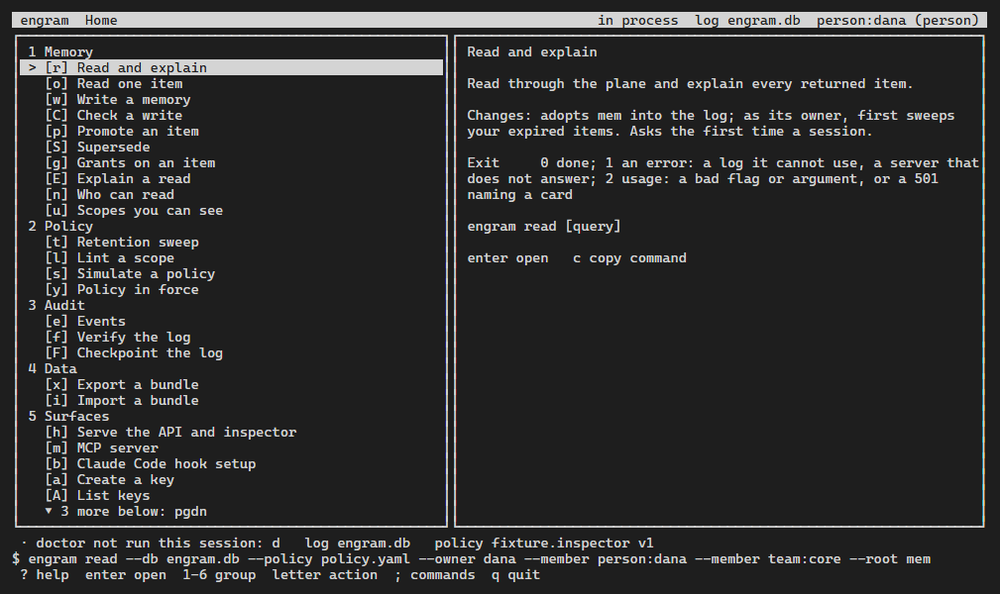

**Write a memory.** A write the gate denies shows the decision first, then the reason and the policy id verbatim, and that nothing was stored; the denial is itself an event. ([An allowed write](../../docs/design/screens/write-allow.png) shows the same parts.)

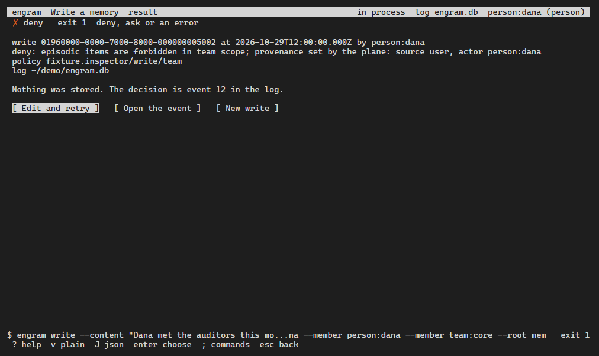

**Read and explain.** The read's id and decision, the counts, the items in person, role and team lanes, and the selected item's score components, admitting rule and validity window. From here `e` opens the [explanation of the whole read](../../docs/design/screens/explain.png), `enter` the [item page](../../docs/design/screens/item.png) (its state, provenance tree, versions and events), `g` its grants and `w` who can read it.

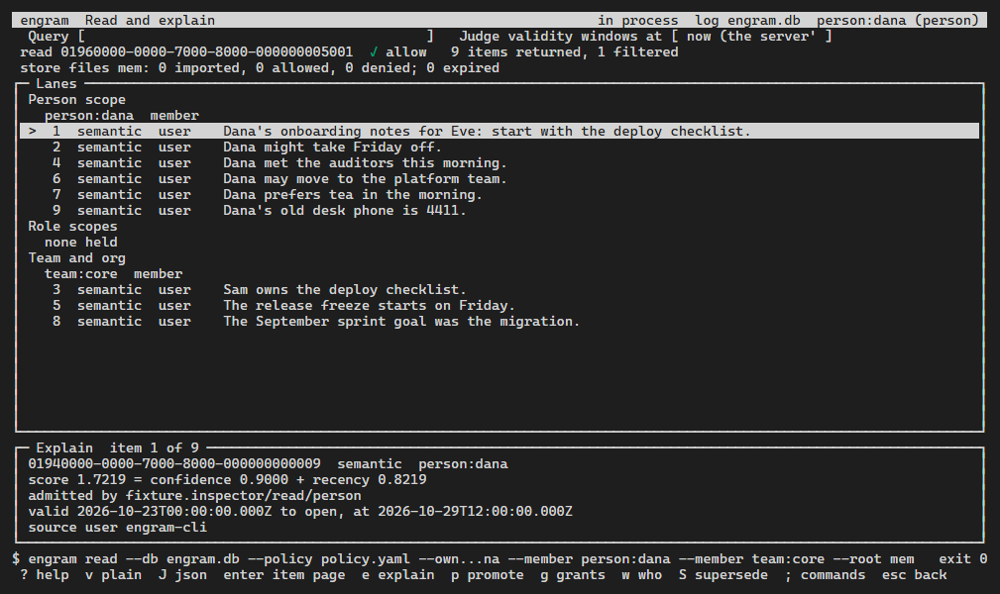

**Grants.** The selected item's grants as its owner sees them, one added as a governed change, and `u` to undo it with another.

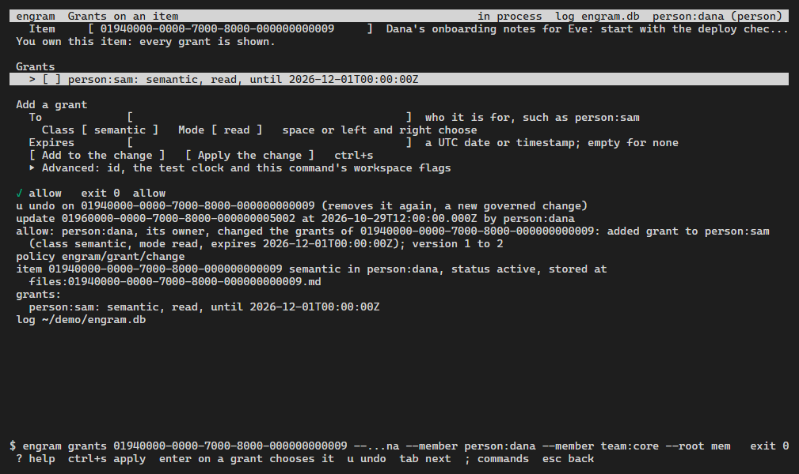

**Doctor.** Every check (log, policy, store, adapters, provider keys by name, pins, Node), failures first, each with what it means.

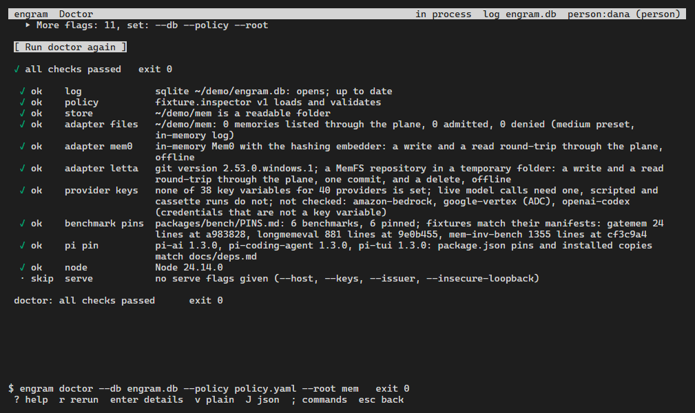

**Events.** The log as the actor may see it, each decision with its policy id and reason, with filters on scope, op, decision and actor, a find over reasons, and `f` to follow new events.

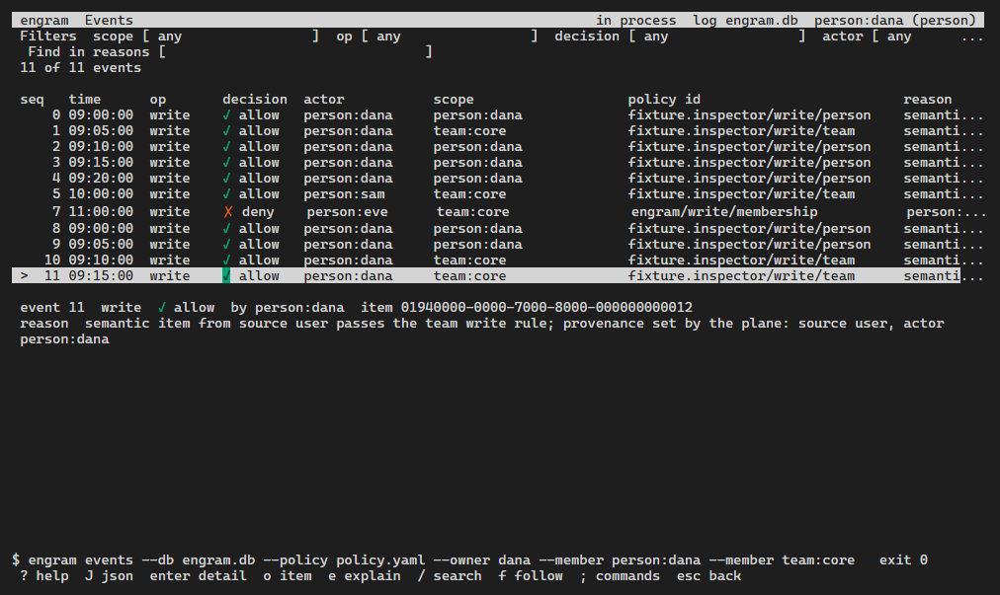

**Simulate.** A recorded workload replayed under the policy in force and a candidate on scratch logs, the totals side by side with bars, and each step whose decision changed. The real log and store are not touched, and no model is called.

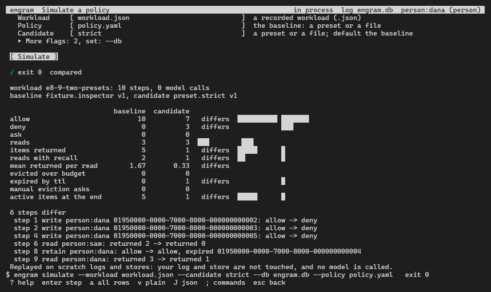

**The command palette.** `;` opens a fuzzy search over every command, its flags and help line, and the TUI's own actions; it also takes a pasted command line.

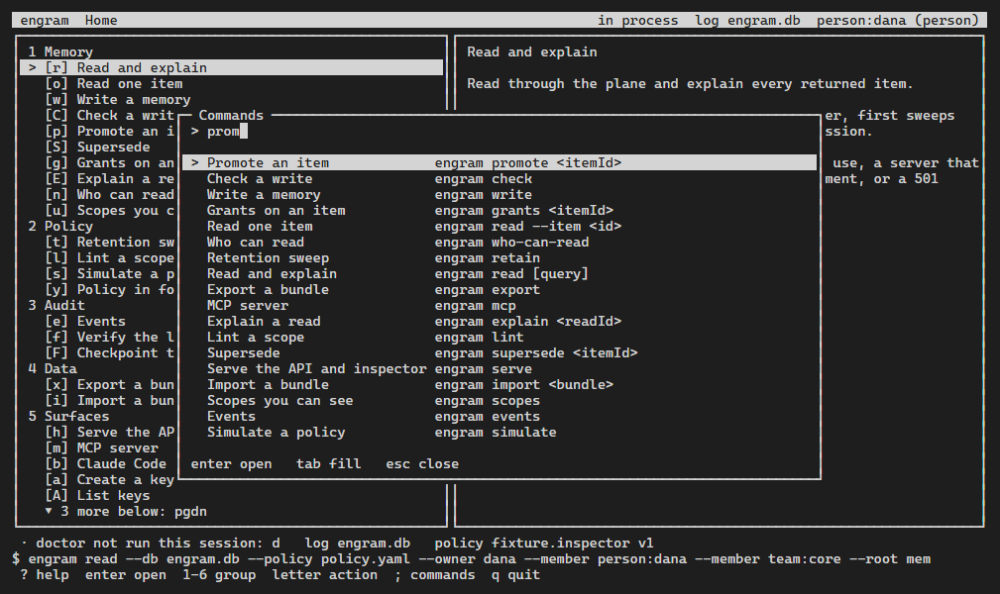

The other screens: [MCP](../../docs/design/screens/mcp.png) (the configuration for Claude Code and Codex over this workspace, and Try it), [Serve](../../docs/design/screens/serve.png) (who may call the server, then its start line and the inspector's URL), [Help](../../docs/design/screens/help.png) (every key the screen binds) and the [actor switcher](../../docs/design/screens/actor.png) (each workspace flag with where its value came from).

### Line mode

`engram tui --line`, `ENGRAM_TUI_LINE=1`, `L` on Home or First run, or the workspace panel's Line mode at start: the plain CLI with prompts, for screen readers and for terminals where a full screen is a burden. It reads with `node:readline` only, never redraws or moves the cursor, uses no colour or box drawing, and asks one question a line. Type a command's number or name and it asks for its flags one at a time (an empty answer keeps the default it names), or type a whole command line. Before a write it shows the gate's decision as `engram check` prints it, then asks. Each command is shown as `run: engram ...` and prints exactly what the plain command prints. `workspace` shows and changes the flags every command gets, `help` explains, `screen` opens the full screen, and `quit` or `exit`, at any question, or end of input (ctrl+D, or ctrl+Z then Enter on Windows) leaves. Its first lines name the actor every command acts as. `mcp` and `hook` are setup only there: they print the configuration to paste and, on request, try it on a scratch log.

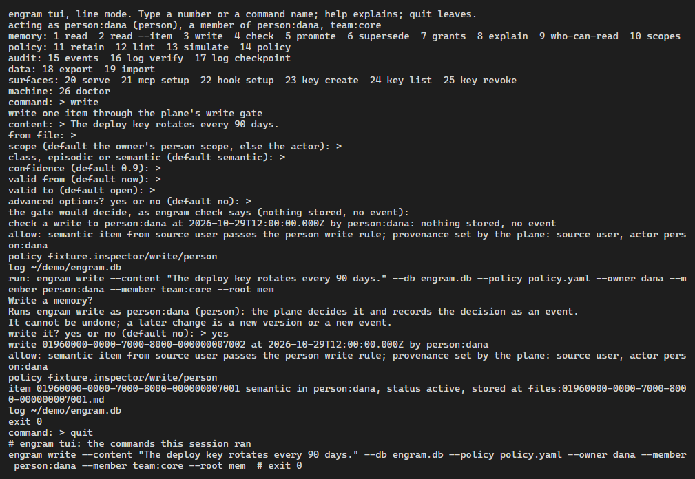

### Themes and sizes

The status hues are a dark or a light set at 4.5:1 or better, chosen from the terminal's answer about its background (OSC 11) or `COLORFGBG`. Colour is only ever on a status symbol, always beside its word.

| | |
|---|---|
| 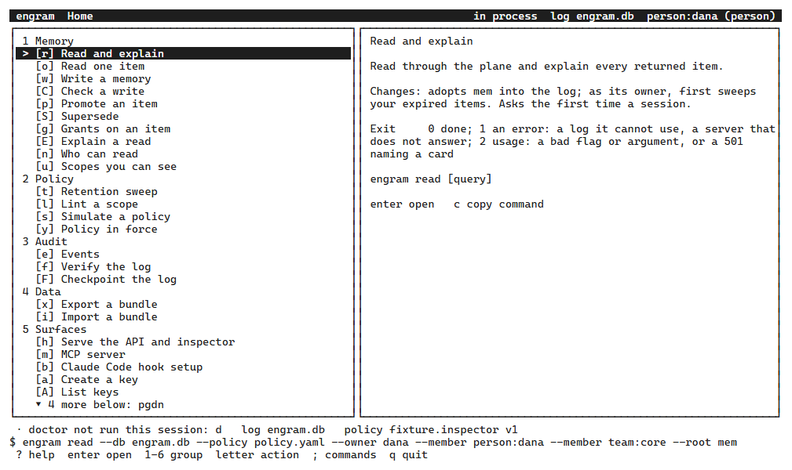 light, chosen from the terminal's background | 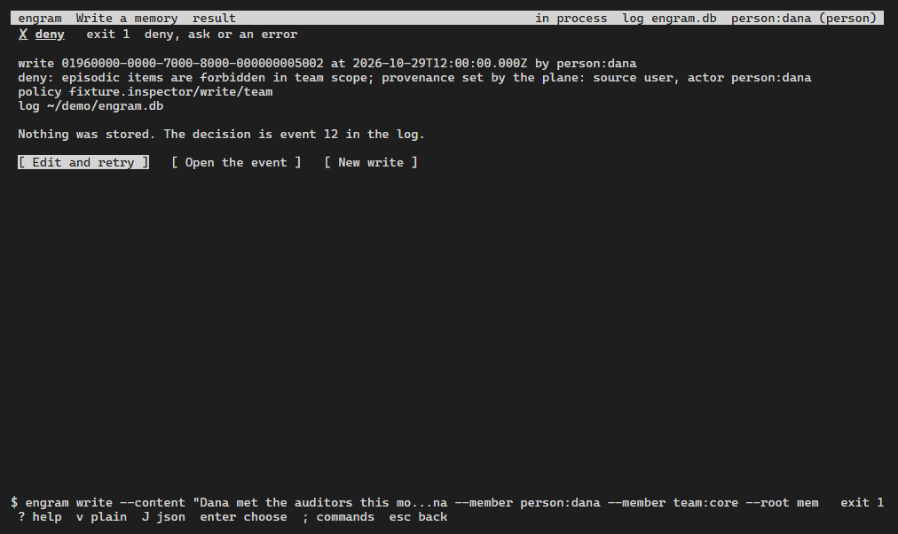 `--high-contrast`: bold and underline, no hue |
| 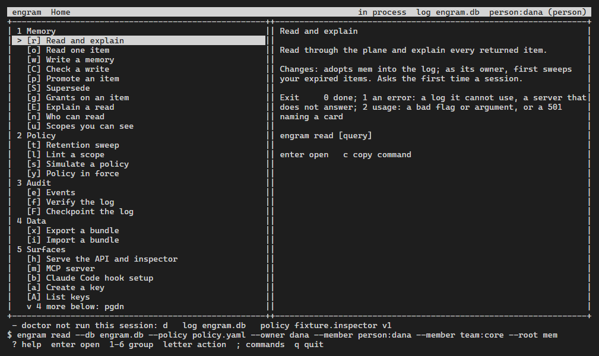 `--ascii`: ASCII only, as under `TERM=linux` or a POSIX locale | 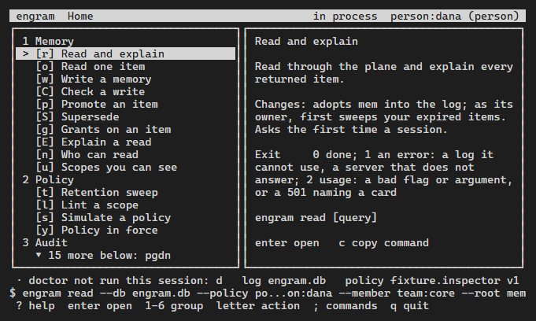 the minimum size, 80x24 |

Every variant exists for Home, Read and the denied write (`home-*`, `read-*`, `write-deny-*` in [`docs/design/screens/`](../../docs/design/screens/index.md)).

### Entering, keys and accessibility

**Entering.** `engram tui` takes the workspace flags (`--server`, `--db`, `--store`, `--root`, `--owner`, `--policy`, `--as`, `--level`, `--member` and the rest), which win over the saved workspace in `<home>/.engram/tui.json` (flags and options only, never content, ids, tokens or a Postgres URL); `--no-saved` ignores it. Without a usable workspace it starts on First run, which asks for a log, a policy and who you are. `--screen <name>` opens on one screen. It refuses, with one line and exit 2, when stdout or stdin is not a terminal, `CI` is set, `TERM` is `dumb` (line mode still starts there) or `--json` is given; under Git Bash without a pseudoconsole it suggests `winpty engram tui`.

**Keys.** `?` (or `ctrl+g` in a field) opens the help for the screen you are on; `;` (or `ctrl+p`, and `alt+p` in a field) the command palette; `ctrl+o` the workspace; `esc` goes back; `q` quits from Home (elsewhere it goes back); `ctrl+c` quits at once and stops a running server. On Home, `1` to `6` jump to a group and each command has its own letter; `enter` opens. In forms, `tab` and `shift+tab` move and `ctrl+s` runs. On results, `v` shows the plain command's exact text output, `J` its `--json` output, `r` runs it again, and `c` (`alt+c` in a field) copies the command line.

**Accessibility.** Everything works from the keyboard. The mouse is captured by default (Shift+drag selects text); `--no-mouse` or `ENGRAM_TUI_MOUSE=0` leaves it to the terminal. `--no-color` or `NO_COLOR` removes every colour. `--high-contrast` or `ENGRAM_TUI_CONTRAST=high` uses bold and underline only. `--ascii` or `ENGRAM_TUI_ASCII=1` draws ASCII only, as do `TERM=linux`, `TERM=vt100` and a POSIX locale without UTF-8; Windows' legacy console (conhost) gets ASCII status symbols with Unicode boxes. `--reduced-motion` or `ENGRAM_TUI_MOTION=reduce` makes the busy indicator a static marker. `--quiet` leaves out the commands printed on quit. On quit the terminal is given back as it was: nothing of the last screen stays in the scrollback. The minimum size is 80x24. What was checked on which terminal is in [`docs/design/tui-manual-check.md`](../../docs/design/tui-manual-check.md).

## Test

```sh
pnpm --filter cli exec vitest run
pnpm exec playwright install chromium   # once: make test-e2e also runs the inspector in Chromium, and make tui-screens renders PNGs with it
make test-e2e        # builds the inspector (make ui) first; layer 6: doctor and a write, read, explain smoke on SQLite and embedded Postgres, on a temp folder and on a Letta repository; engram tui under a pseudoconsole (skipped, with its reason, where none can be had)
make tui-screens     # regenerate docs/design/screens/
```

`test/commands.test.ts` holds the help snapshot (card E8.2's acceptance) and `test/main.test.ts` runs the binary as a process; there is a test file per command (`write`, `read`, `check`, `explain`, `promote`, `supersede`, `grants`, `who-can-read`, `scopes`, `events`, `policy`, `simulate`, `export` and `import`, `log`, `doctor`, `hook`), `test/verified-actors.test.ts` covers the authenticated server, and `test/redaction.property.test.ts` checks that no secret in a Postgres URL reaches the output. The TUI's layers are under `test/tui/`: frames in four modes, keys, flows, parity with the plain commands, line mode, accessibility, no policy logic, and a byte test of three screenshot frames.

## What is next

From the second absorb plan ([`docs/tasks/absorb-plan-2.md`](../../docs/tasks/absorb-plan-2.md)), each a card of its own, none merged yet:

- Card E9.10: `engram discover`, which counts the harness memory that lives outside the plane, and its doctor check.
- Card E8.17: a Codex PreToolUse hook beside `engram hook claude-code`, with an idempotent installer.
- Card E2.20: `engram policy test` and `engram policy diff` with a ceiling.
- Cards E2.19 and E8.8: an approval queue for held writes, on every surface.
- Cards E9.14, E9.15 and E9.16: a signed erasure receipt, a signed audit report, and a subject access export.
